# Rust Mining Co — Phase 2 report (ecology)

Generated 2026-10-23T05:38:09Z at commit fda024b. Design: [docs/SAD-P2.md](SAD-P2.md). The whole build, with every decision and blocker: [docs/REPORT.md](REPORT.md). Playtester reports: [docs/PLAYTEST.md](PLAYTEST.md).

**60 / 60 Phase 2 features passing, 0 skipped, 0 not passing.**

**SAD-P2 §13 performance targets missed or not measured** (details under Phase 2 performance below):

- Season tick, steady rain, 50 edits in one chunk: Missed: about 3.6–4.4 s. Shipped tables with rain overridden to 128 in every row; after 2 rainy seasons, 50 single-cell digs in chunk (1, 1, 1), then one timed season. Flow is about 2 s of it, mostly air↔water conversions through `World::eco_set` (about 394 k material changes a season); transport about 0.6 s.
- Snapshots + remesh after a season: Not measured (host and client side).

## How to watch the seasons

```
cargo run --release -p rmc_app -- --seed 42
cargo run --release -p rmc_app -- --headless --seasons 4 --save season-run
```

In the game, `F6` advances one season and `F7` steps through the layer overlays. The editor's eco panel shows the last season's report; see [docs/CONTROLS.md](CONTROLS.md). The headless run writes `report.json` (every season's ledger and invariant check) into its save directory.

## Milestones

| milestone | passing | skipped | not passing |
|---|---|---|---|
| E0 | 10 / 10 | 0 |  |
| E1 | 5 / 5 | 0 |  |
| E2 | 11 / 11 | 0 |  |
| E2b | 5 / 5 | 0 |  |
| E3 | 9 / 9 | 0 |  |
| E3b | 6 / 6 | 0 |  |
| E4 | 3 / 3 | 0 |  |
| E5 | 11 / 11 | 0 |  |

## Feature status

| id | milestone | title | status | tests |
|---|---|---|---|---|
| F100 | E0 | rmc_eco crate (Bevy-free) and Phase 2 data files loading with hashes | passed | `cargo:rmc_eco:tables::tests::loads_all_phase2_tables`<br>`cargo:rmc_eco:tables::tests::tables_hash_is_stable`<br>`cargo:rmc_world:materials::tests::phase1_table_loads_with_phase2_defaults` |
| F101 | E0 | Chunk layers, PlantState map, eco_revision, surface_y column cache (i16) | passed | `cargo:rmc_world:layers::tests::absent_layer_reads_zero`<br>`cargo:rmc_world:layers::tests::compact_drops_zero_keeps_temperature_and_light`<br>`cargo:rmc_world:layers::tests::chunk_hash_covers_layers_and_plants`<br>`cargo:rmc_world:columns::tests::surface_y_matches_brute_force_proptest` |
| F102 | E0 | Save format v2 with layers and plant state; v1 rejected | passed | `cargo:rmc_world:save::tests::v2_roundtrip_with_layers_and_plants_hash_identical`<br>`cargo:rmc_world:save::tests::v1_rejected_with_version_message`<br>`cargo:rmc_world:save::tests::tables_hash_mismatch_fails` |
| F103 | E0 | Protocol v2: ChunkSnapshot v2, LayerSnapshot, ChunkDelta::Layers, AdvanceSeason, SetLayer; SeasonLedger in rmc_world; displacement rules shared by World::apply and World::eco_set | passed | `cargo:rmc_protocol:codec::tests::roundtrip_phase2_variants`<br>`cargo:rmc_world:edit::tests::set_layer_emits_layers_delta_and_bumps_eco_revision`<br>`cargo:rmc_world:edit::tests::displacement_rules_every_case_ledgered`<br>`cargo:rmc_world:edit::tests::brush_set_water_fill_255_set_magma_init_temp`<br>`cargo:rmc_world:edit::tests::eco_set_displaces_bumps_revision_no_delta` |
| F104 | E0 | Invariant checker over rmc_world's SeasonLedger, Jacobi runner (parallel, 1-cell border), sweep runner (global order), active sets, flat-array reference | passed | `cargo:rmc_eco:runner::tests::jacobi_parallel_equals_serial_hash`<br>`cargo:rmc_eco:runner::tests::apply_in_sorted_chunk_order`<br>`cargo:rmc_eco:runner::tests::sweep_visits_global_y_cz_cx_lz_lx_order`<br>`cargo:rmc_eco:runner::tests::active_set_includes_receivers`<br>`cargo:rmc_eco:invariants::tests::checker_detects_created_water` |
| F105 | E0 | Activity tracking: quiet counters, skip, reactivation by edits and neighbors | passed | `cargo:rmc_eco:activity::tests::quiet_chunk_skipped_after_threshold`<br>`cargo:rmc_eco:activity::tests::edit_reactivates_neighbors`<br>`cargo:rmc_eco:activity::tests::season_boundary_reactivates_surface_chunks`<br>`cargo:rmc_eco:activity::tests::skipping_changes_no_result_on_constant_fixture` |
| F106 | E0 | Temperature pass: surface/sky clamps, pair-symmetric truncating i32 flux, energy update; worldgen temperature profile layer | passed | `cargo:rmc_eco:temperature::tests::energy_nonincreasing_without_sources`<br>`cargo:rmc_eco:temperature::tests::unequal_capacity_edge_conserves_energy`<br>`cargo:rmc_eco:temperature::tests::maximum_principle_proptest`<br>`cargo:rmc_eco:temperature::tests::spread_nonincreasing`<br>`cargo:rmc_eco:temperature::tests::linear_profile_is_fixed_point`<br>`cargo:rmc_eco:temperature::tests::flux_antisymmetric_proptest`<br>`cargo:rmc_eco:temperature::tests::heat_source_stays_clamped`<br>`cargo:rmc_eco:temperature::tests::surface_clamp_pond_top_and_open_air_not_under_overhang`<br>`cargo:rmc_eco:temperature::tests::surface_cell_follows_seasonal_swing`<br>`cargo:rmc_eco:temperature::tests::deep_profile_cell_quiet_20_substeps`<br>`cargo:rmc_eco:temperature::tests::two_chunk_equals_one_chunk`<br>`cargo:rmc_worldgen:temperature::tests::profile_bottom_equals_profile_fn` |
| F107 | E0 | season_tick on the host; AdvanceSeason pauses edits; ChunkSnapshot/LayerSnapshot by revision kind; SeasonDone | passed | `cargo:rmc_host:season::tests::advance_season_roundtrip`<br>`cargo:rmc_host:replica::tests::equivalence_after_three_seasons_with_edits_between`<br>`cargo:rmc_eco:tick::tests::whole_tick_deterministic_100`<br>`cargo:rmc_host:season::tests::layer_snapshot_sent_for_eco_only_changes`<br>`cargo:rmc_host:season::tests::between_seasons_ledger_merged` |
| F108 | E0 | Headless --seasons N CLI with --world-size; default 128x64x128 for Phase 2 | passed | `cargo:rmc_app:cli::tests::headless_seasons_writes_report`<br>`cargo:rmc_app:cli::tests::default_world_size_is_32_chunks` |
| F109 | E0 | Testkit: advance_season, layer readers, ledger, set_layer, fixtures, season overrides; editor Season button | passed | `cargo:rmc_testkit:eco::tests::advance_season_applies_both_snapshot_kinds`<br>`cargo:rmc_testkit:eco::tests::fixture_pit_builds_expected_cells`<br>`cargo:rmc_testkit:eco::tests::set_season_params_overrides_rain`<br>`cargo:rmc_client:editor::tests::season_button_sends_advance_season` |
| F110 | E1 | Freeze-thaw season bitset | passed | `cargo:rmc_eco:weathering::tests::freeze_thaw_bit_set_on_zero_crossing`<br>`cargo:rmc_eco:weathering::tests::freeze_thaw_bit_cleared_at_season_start` |
| F111 | E1 | Weathering pass: regolith growth when exposed and moist, freeze-thaw doubling | passed | `cargo:rmc_eco:weathering::tests::regolith_only_when_exposed_and_moist`<br>`cargo:rmc_eco:weathering::tests::freeze_thaw_doubles_rate`<br>`cargo:rmc_eco:weathering::tests::unexposed_control_unchanged` |
| F112 | E1 | Gradual composition release during weathering; conversion at 255 | passed | `cargo:rmc_eco:weathering::tests::release_proportional_to_actual_delta`<br>`cargo:rmc_eco:weathering::tests::release_complete_within_rounding`<br>`cargo:rmc_eco:weathering::tests::converts_at_255`<br>`cargo:rmc_eco:weathering::tests::ledger_weather_in_and_saturation_loss` |
| F113 | E1 | Regolith halves pickaxe hardness; yield_material | passed | `cargo:rmc_world:damage::tests::regolith_halves_hardness`<br>`cargo:rmc_world:damage::tests::yield_material_overrides_self` |
| F114 | E1 | E2E: freeze_thaw_weathers_cut | passed | `e2e:freeze_thaw_weathers_cut` |
| F120 | E2 | Water material with fill; air↔water via delta | passed | `cargo:rmc_eco:water::tests::air_with_moisture_becomes_water`<br>`cargo:rmc_eco:water::tests::water_at_zero_fill_becomes_air` |
| F121 | E2 | Water sweep: down and sideways with donor/receiver checks; invariant proptest | passed | `cargo:rmc_eco:water::tests::invariant_exact_after_every_sweep_proptest`<br>`cargo:rmc_eco:water::tests::oracle_equivalence_flat_sweep_proptest`<br>`cargo:rmc_eco:water::tests::pit_fills_before_overflow`<br>`cargo:rmc_eco:water::tests::sideways_halves_difference_with_cap`<br>`cargo:rmc_eco:water::tests::receiver_never_exceeds_255` |
| F122 | E2 | Infiltration into porous solids, field capacity, seepage threshold | passed | `cargo:rmc_eco:water::tests::porous_column_fills_to_capacity_and_stops`<br>`cargo:rmc_eco:water::tests::seepage_into_pit_below_table`<br>`cargo:rmc_eco:water::tests::impermeable_blocks_infiltration` |
| F123 | E2 | Condensation (start of pass), evaporation to steam (actual amounts), rain at surface_y+1 or into the anchor under a plant | passed | `cargo:rmc_eco:water::tests::evaporation_limited_by_steam_room_ledger_actual`<br>`cargo:rmc_eco:water::tests::condensation_below_temp_returns_steam`<br>`cargo:rmc_eco:water::tests::steam_above_sky_open_pond_vents_not_condenses`<br>`cargo:rmc_eco:water::tests::rain_targets_surface_plus_one_or_anchor_never_overhang`<br>`cargo:rmc_eco:water::tests::rain_ledger_records_actual`<br>`cargo:rmc_eco:water::tests::rain_pattern_is_seeded` |
| F124 | E2 | Whole-tick invariants on random worlds and sweep oracle on multi-chunk worlds | passed | `cargo:rmc_eco:water::tests::oracle_equivalence_multi_chunk_world`<br>`cargo:rmc_eco:tick::tests::invariants_hold_after_each_pass_20_worlds` |
| F125 | E2 | Ice: transitions water↔ice with hysteresis, moisture preserved | passed | `cargo:rmc_eco:transitions::tests::water_freezes_below_zero`<br>`cargo:rmc_eco:transitions::tests::ice_melts_above_hysteresis`<br>`cargo:rmc_eco:transitions::tests::moisture_preserved_across_freeze`<br>`cargo:rmc_eco:transitions::tests::table_order_precedence` |
| F126 | E2 | Worldgen water table and flooded caves | passed | `cargo:rmc_worldgen:water::tests::porous_below_table_at_capacity`<br>`cargo:rmc_worldgen:water::tests::caves_below_table_flooded` |
| F127 | E2 | Liquid mesh pass: fill-height top faces, translucency, substance tint hook | passed | `cargo:rmc_client:mesher::tests::liquid_top_face_at_fill_height`<br>`cargo:rmc_client:mesher::tests::liquid_faces_in_second_mesh` |
| F128 | E2 | E2E: season_swale_fills | passed | `e2e:season_swale_fills` |
| F129 | E2 | E2E: pit_becomes_pond | passed | `e2e:pit_becomes_pond` |
| F130 | E2b | Magma as whole-cell liquid: viscosity-gated swaps with air carrying temperature; magma count ledger | passed | `cargo:rmc_eco:water::tests::magma_swaps_with_air_and_carries_temperature`<br>`cargo:rmc_eco:water::tests::magma_viscosity_gates_moves`<br>`cargo:rmc_eco:water::tests::magma_never_enters_water_or_porous`<br>`cargo:rmc_eco:water::tests::magma_count_invariant` |
| F131 | E2b | Transitions: magma→basalt on cooling, stone→magma near a core; contact boiling in the water sweep → obsidian + steam | passed | `cargo:rmc_eco:transitions::tests::magma_cools_to_basalt_away_from_source`<br>`cargo:rmc_eco:transitions::tests::worldgen_magma_stays_molten_20_substeps`<br>`cargo:rmc_eco:water::tests::contact_boiling_whole_fill_obsidian_one_event`<br>`cargo:rmc_eco:transitions::tests::stone_tag_melts_near_source` |
| F132 | E2b | Worldgen magma chambers with cores, never touching bedrock | passed | `cargo:rmc_worldgen:magma::tests::chambers_have_source_core_and_init_temp`<br>`cargo:rmc_worldgen:magma::tests::chambers_clear_of_bedrock` |
| F133 | E2b | Materials: magma, obsidian, basalt colors; HUD temperature at player | passed | `cargo:rmc_client:hud::tests::hud_shows_player_cell_temperature` |
| F134 | E2b | E2E: magma_meets_water | passed | `e2e:magma_meets_water` |
| F140 | E3 | Substance layers, composition, substances.ron with yield materials; sulfide_ore, limestone (porous, carbonate), crushed_sulfide, copper_dust | passed | `cargo:rmc_world:layers::tests::substance_layers_index_by_table`<br>`cargo:rmc_worldgen:strata::tests::limestone_band_present_and_porous`<br>`cargo:rmc_world:damage::tests::sulfide_yields_crushed_sulfide` |
| F141 | E3 | Chemistry transport replaying the MoveLog by mobility and pH | passed | `cargo:rmc_eco:chemistry::tests::transport_replays_movelog_invariant_proptest`<br>`cargo:rmc_eco:chemistry::tests::transport_scaling_by_256_then_fill`<br>`cargo:rmc_eco:chemistry::tests::immobile_substance_stays`<br>`cargo:rmc_eco:chemistry::tests::mobility_acid_used_below_acid_ph` |
| F142 | E3 | pH derivation and reactions runner (table order, first match, where-conditions) | passed | `cargo:rmc_eco:chemistry::tests::ph_derivation_i32_no_underflow`<br>`cargo:rmc_eco:chemistry::tests::each_reaction_fires_only_on_condition`<br>`cargo:rmc_eco:chemistry::tests::reaction_order_precedence`<br>`cargo:rmc_eco:chemistry::tests::react_delta_and_saturation_loss_balance` |
| F143 | E3 | Oxidation, neutralization, carbonate dissolution, copper mobility under acid | passed | `cargo:rmc_eco:chemistry::tests::exposed_sulfide_releases_s_then_oxidizes`<br>`cargo:rmc_eco:chemistry::tests::acid_plus_lime_makes_salt`<br>`cargo:rmc_eco:chemistry::tests::dissolve_carbonate_in_porous_limestone_fed_by_seepage`<br>`cargo:rmc_eco:chemistry::tests::acid_increases_copper_transport` |
| F144 | E3 | Coating and crusts: ochre on floors at pH>5, salt on evaporation; crusts dig back to substances | passed | `cargo:rmc_eco:chemistry::tests::ochre_crust_forms_on_submerged_floor`<br>`cargo:rmc_eco:chemistry::tests::salt_crust_on_floor_under_drying_pool`<br>`cargo:rmc_eco:chemistry::tests::coat_across_chunk_border_queued_additive`<br>`cargo:rmc_world:damage::tests::digging_crust_leaves_substance_on_cell` |
| F145 | E3 | Spoil query and toxicity profiles; HUD spoil indicator; editor cell readout | passed | `cargo:rmc_world:query::tests::spoil_cells_match_profile`<br>`cargo:rmc_client:hud::tests::spoil_indicator_follows_target` |
| F146 | E3 | Water tint by dissolved substances | passed | `cargo:rmc_client:mesher::tests::water_color_shifts_with_fe` |
| F147 | E3 | E2E: tailings_acidify_downslope | passed | `e2e:tailings_acidify_downslope` |
| F148 | E3 | E2E: limestone_channel_clears | passed | `e2e:limestone_channel_clears` |
| F150 | E2 | Gas concentration layers, gases.ron, active sets per gas; drift and diffusion with room checks | passed | `cargo:rmc_eco:gases::tests::light_gas_collects_at_ceiling`<br>`cargo:rmc_eco:gases::tests::heavy_gas_collects_at_floor`<br>`cargo:rmc_eco:gases::tests::drift_and_diffusion_conserve_with_room_checks` |
| F151 | E3b | Venting to sky and emission from exposed emitters (coal → firedamp) | passed | `cargo:rmc_eco:gases::tests::vent_only_sky_open`<br>`cargo:rmc_eco:gases::tests::emission_only_when_exposed_actual_amounts`<br>`cargo:rmc_eco:gases::tests::invariant_per_kind_including_steam_terms_proptest`<br>`cargo:rmc_eco:gases::tests::sealed_pocket_drains_through_shaft` |
| F152 | E3b | Steam water terms in both invariants; condensation/vent interplay | passed | `cargo:rmc_eco:gases::tests::boil_all_converts_fill_to_steam_1to1`<br>`cargo:rmc_eco:water::tests::water_invariant_includes_steam_and_vent` |
| F153 | E3b | Ignition by magma/heat source: gas to smoke, diggable cells of the sphere to air via World::eco_set | passed | `cargo:rmc_eco:gases::tests::ignition_clears_diggable_sphere_smoke_by_room_displacement_ledgered`<br>`cargo:rmc_eco:gases::tests::no_ignition_below_min` |
| F154 | E3b | Gas tint at camera and HUD gas readout with lantern icon | passed | `cargo:rmc_client:hud::tests::gas_readout_follows_camera_cell` |
| F155 | E3b | Chokedamp from organic decomposition reaction | passed | `cargo:rmc_eco:chemistry::tests::decompose_c_to_n_emits_chokedamp` |
| F156 | E3b | E2E: firedamp_vented_by_shaft | passed | `e2e:firedamp_vented_by_shaft` |
| F160 | E4 | Light: global column pass (y descending) and global lateral Jacobi; passable transparent; dirty-flag triggered; worldgen initial light | passed | `cargo:rmc_eco:light::tests::open_column_full_overhang_zero`<br>`cargo:rmc_eco:light::tests::lateral_falloff`<br>`cargo:rmc_eco:light::tests::water_attenuates_passable_transparent`<br>`cargo:rmc_eco:light::tests::recomputed_only_when_dirty`<br>`cargo:rmc_worldgen:light::tests::initial_light_nonzero_at_surface` |
| F161 | E4 | Layer overlay color source in the mesher and editor picker | passed | `cargo:rmc_client:mesher::tests::overlay_colors_from_layer`<br>`cargo:rmc_client:editor::tests::overlay_pick_triggers_remesh` |
| F162 | E4 | E2E: layer_overlay_renders | passed | `e2e:layer_overlay_renders` |
| F165 | E5 | Plant species table, plant cells as passable solids, PlantState map, needs check and growth | passed | `cargo:rmc_eco:plants::tests::needs_met_grows`<br>`cargo:rmc_eco:plants::tests::stress_death_litter_ledgered_source`<br>`cargo:rmc_client:controller::tests::walks_through_passable_plant` |
| F166 | E5 | Spread by seeded hash onto passing anchors within radius | passed | `cargo:rmc_eco:plants::tests::spread_only_onto_passing_anchors`<br>`cargo:rmc_eco:plants::tests::spread_is_seeded_deterministic`<br>`cargo:rmc_eco:plants::tests::no_double_claim_across_chunk_border` |
| F167 | E5 | Uptake and held substances; fireweed hyperaccumulation; harvest yields substance material | passed | `cargo:rmc_eco:plants::tests::uptake_invariant_over_life_death_harvest`<br>`cargo:rmc_eco:plants::tests::fireweed_holds_copper_anchor_cu_falls`<br>`cargo:rmc_eco:plants::tests::fireweed_survives_copper_grass_dies`<br>`cargo:rmc_testkit:eco::tests::harvest_yields_copper_dust_and_ledgers` |
| F168 | E5 | Worldgen surface plants on passing anchors | passed | `cargo:rmc_worldgen:plants::tests::initial_plants_only_on_passing_anchors` |
| F169 | E5 | Editor eco panel: layer picker, season report summary, place water/ice/magma/crushed_sulfide, cell readout | passed | `cargo:rmc_client:editor::tests::eco_panel_lists_layers_and_report` |
| F170 | E5 | E2E: grass_greens_swale and fireweed_takes_copper | passed | `e2e:grass_greens_swale`<br>`e2e:fireweed_takes_copper` |
| F171 | E5 | E2E: tailings_kill_moss | passed | `e2e:tailings_kill_moss` |
| F172 | E5 | Benches: tick_quiet, tick_first, water_sweep_world, chem_transport_world (lib fns + integration test runs each once); docs/perf-p2.md | passed | `cargo:rmc_eco:benches_run_once` |
| F173 | E5 | Performance pass against §13; activity tuning | passed | `cargo:rmc_eco:tick::tests::quiet_world_tick_under_dev_budget`<br>`e2e:season_swale_fills` |
| F174 | E5 | E2E: soak_seasons (chaos + 20 seasons × 3, conservation and equivalence) | passed | `e2e:soak_seasons` |
| F175 | E5 | Playtester report, screenshot gallery, docs/REPORT-P2.md | passed | `cargo:rmc_app:report::tests::report_p2_includes_ledgers_and_screens` |

## Soak: ledgers of the last soak_seasons run

From `target/e2e/soak_seasons-stats.txt`, which the scenario writes only after all of its seeds pass (the file is not committed; this table is its copy). Each seed runs ChaosBot for 600 frames, then 20 seasons on the default world. After every season it checks every conservation invariant against the ledger and the replica hash against the host's (F174).

The ledger holds everything the world gained and lost since before the soak's fixture was laid. Units: the water terms (`rain_in` to `condense_from_steam`) are moisture units, 255 to a full cell; the substance arrays are layer units; the gas arrays are concentration units; the magma terms are cells; the rest are counts. Zero entries of the per-substance and per-gas arrays are left out.

Not exercised by this run (zero in every seed), so the invariants behind them were not tested here: `water_edit_out`, `harvest_out`, `edit_out`, `saturation_loss`, `react_out`, `react_in`, `gas_edit_in`, `gas_edit_out`, `magma_melt_in`, `magma_edit`, `plants_born`, `ignitions`.

| field | seed 1 | seed 2 | seed 3 |
|---|---|---|---|
| `rain_in` | 270389391 | 270304298 | 261658008 |
| `steam_vent_out` | 4809781 | 4696160 | 4567197 |
| `water_edit_in` | 8115 | 4800 | 10155 |
| `water_edit_out` | 0 | 0 | 0 |
| `water_saturation_loss` | 201350 | 266166 | 1168554 |
| `evap_to_steam` | 8121743 | 8106749 | 8111820 |
| `boil_to_steam` | 85387 | 41310 | 1012495 |
| `condense_from_steam` | 3158878 | 3157342 | 3321249 |
| `weather_in` | cu 3248, fe 2077, s 4424 | cu 3132, fe 1998, s 4266 | cu 3248, fe 2096, s 4424 |
| `litter_in` | c 1080 | c 1080 | c 1080 |
| `uptake_sink` | n 705, p 480, k 240 | n 705, p 480, k 240 | n 705, p 480, k 240 |
| `harvest_out` | 0 | 0 | 0 |
| `edit_in` | cu 8192, fe 8192, s 8192, acid 8192, lime 8192, salt 8192, n 8192, p 8192, k 8192, c 8192 | cu 8192, fe 8192, s 8192, acid 8192, lime 8192, salt 8192, n 8192, p 8192, k 8192, c 8192 | cu 8192, fe 8192, s 8192, acid 8192, lime 8192, salt 8192, n 8192, p 8192, k 8192, c 8192 |
| `edit_out` | 0 | 0 | 0 |
| `react_delta` | s -80, acid -6968, lime -7048, salt 7048, n 2318, c -9272 | s -204, acid -6852, lime -7056, salt 7056, n 2318, c -9272 | s -80, acid -6958, lime -7038, salt 7038, n 2318, c -9272 |
| `saturation_loss` | 0 | 0 | 0 |
| `emit_in` | firedamp 1039746 | firedamp 1166376 | firedamp 982274 |
| `vent_out` | steam 4809781 | steam 4696160 | steam 4567197 |
| `react_out` | 0 | 0 | 0 |
| `react_in` | 0 | 0 | 0 |
| `gas_edit_in` | 0 | 0 | 0 |
| `gas_edit_out` | 0 | 0 | 0 |
| `gas_saturation_loss` | steam 201350, firedamp 118190 | steam 266166, firedamp 106626 | steam 1168554, firedamp 114907 |
| `magma_set` | 167 | 176 | 226 |
| `magma_melt_in` | 0 | 0 | 0 |
| `magma_edit` | 0 | 0 | 0 |
| `transitions` | water → air 1132, water → ice 1227937, magma → basalt 151, ice → water 134543 | water → ice 1234295, magma → basalt 176, ice → water 143754, water → air 162 | water → air 8014, water → ice 1231000, magma → basalt 143, ice → water 140955 |
| `weathered_cells` | 4410 | 6448 | 3696 |
| `plants_born` | 0 | 0 | 0 |
| `plants_died` | 63 | 63 | 63 |
| `ignitions` | 0 | 0 | 0 |

### Seed 1

Chaos: 13 actions (Walk 3, Look 2, Dig 3, Place 2, Jump 3), 8 swings, 4 brush clicks, 3 jumps, feet [64.25, 47.501, 64.25] -> [71.53066, 47.501, 65.99211].

Cycle sums (first season, ms): [(4, 70019), (8, 73471), (12, 48174), (16, 40316)]

Per season: `ms` is the season's wall-clock time in the dev profile on the test kit's host (not the release benches under performance); the other columns are that season's counts and ledger terms.

| season | ms | active_cells | jacobi_chunks | changed_chunks | rain_in | evap_to_steam | steam_vent_out |
|---|---|---|---|---|---|---|---|
| 0 | 12566 | 11000768 | 10240 | 192 | 32782543 | 477739 | 334861 |
| 1 | 14648 | 14494514 | 10240 | 192 | 16232872 | 771849 | 667577 |
| 2 | 14261 | 14502587 | 10240 | 192 | 40939712 | 565959 | 595252 |
| 3 | 12197 | 12129054 | 10240 | 192 | 12087488 | 66505 | 126477 |
| 4 | 18554 | 21160919 | 10240 | 192 | 32863168 | 611169 | 397784 |
| 5 | 18345 | 23533483 | 10240 | 192 | 16323352 | 856559 | 681433 |
| 6 | 17589 | 22007469 | 10240 | 190 | 40779048 | 659037 | 582586 |
| 7 | 15531 | 19662096 | 10240 | 190 | 12083800 | 151556 | 122035 |
| 8 | 21039 | 26890293 | 10240 | 190 | 32403378 | 679009 | 409819 |
| 9 | 20278 | 28396734 | 10240 | 190 | 14246525 | 824074 | 621930 |
| 10 | 17984 | 24727084 | 10240 | 191 | 18491982 | 438634 | 254912 |
| 11 | 14170 | 18857781 | 10240 | 191 | 57507 | 200607 | 3042 |
| 12 | 13486 | 17547993 | 10240 | 191 | 642539 | 219013 | 2386 |
| 13 | 12228 | 14929910 | 10240 | 191 | 455477 | 230649 | 9687 |
| 14 | 11422 | 13392739 | 10240 | 191 | 0 | 220308 | 0 |
| 15 | 11038 | 12651636 | 10240 | 191 | 0 | 223522 | 0 |
| 16 | 10493 | 11622490 | 10240 | 189 | 0 | 226798 | 0 |
| 17 | 10126 | 11004651 | 10240 | 189 | 0 | 230533 | 0 |
| 18 | 9911 | 10710943 | 10240 | 189 | 0 | 233237 | 0 |
| 19 | 9786 | 10242309 | 10240 | 189 | 0 | 234986 | 0 |

### Seed 2

Chaos: 13 actions (Walk 3, Look 2, Dig 3, Place 2, Jump 3), 0 swings, 6 brush clicks, 3 jumps, feet [64.25, 51.001, 64.25] -> [59.267853, 51.001, 61.59672].

Cycle sums (first season, ms): [(4, 71930), (8, 75331), (12, 51030), (16, 41227)]

Per season: `ms` is the season's wall-clock time in the dev profile on the test kit's host (not the release benches under performance); the other columns are that season's counts and ledger terms.

| season | ms | active_cells | jacobi_chunks | changed_chunks | rain_in | evap_to_steam | steam_vent_out |
|---|---|---|---|---|---|---|---|
| 0 | 12714 | 11248443 | 10240 | 193 | 32982986 | 479896 | 336234 |
| 1 | 14713 | 14644566 | 10240 | 193 | 16252072 | 769212 | 664010 |
| 2 | 14442 | 14657144 | 10240 | 193 | 40902480 | 567340 | 590611 |
| 3 | 12528 | 12283625 | 10240 | 193 | 12071376 | 68224 | 127334 |
| 4 | 18844 | 21249159 | 10240 | 193 | 32820392 | 613692 | 399430 |
| 5 | 18773 | 23684502 | 10240 | 193 | 16356608 | 858005 | 679190 |
| 6 | 18180 | 22270072 | 10240 | 193 | 41030080 | 657223 | 578347 |
| 7 | 16133 | 19965718 | 10240 | 194 | 12105944 | 148287 | 118469 |
| 8 | 21352 | 27058730 | 10240 | 194 | 30381157 | 648099 | 374561 |
| 9 | 20734 | 28350242 | 10240 | 194 | 13073755 | 780308 | 547750 |
| 10 | 18402 | 25139017 | 10240 | 194 | 19680570 | 464439 | 242036 |
| 11 | 14843 | 20104877 | 10240 | 194 | 109634 | 209915 | 3466 |
| 12 | 14465 | 18827280 | 10240 | 194 | 871581 | 229561 | 4213 |
| 13 | 13340 | 16292259 | 10240 | 194 | 1306809 | 264411 | 29196 |
| 14 | 12019 | 14173902 | 10240 | 194 | 290520 | 224196 | 1107 |
| 15 | 11206 | 12916690 | 10240 | 194 | 0 | 221826 | 0 |
| 16 | 10787 | 11815614 | 10240 | 194 | 0 | 223109 | 0 |
| 17 | 10355 | 11080855 | 10240 | 194 | 15686 | 225322 | 100 |
| 18 | 10191 | 10723891 | 10240 | 194 | 52648 | 226848 | 106 |
| 19 | 9894 | 10198281 | 10240 | 194 | 0 | 226836 | 0 |

### Seed 3

Chaos: 14 actions (Walk 2, Look 3, Dig 3, Place 3, Jump 3), 8 swings, 6 brush clicks, 3 jumps, feet [64.25, 45.001, 64.25] -> [66.57013, 45.001, 69.56484].

Cycle sums (first season, ms): [(4, 70579), (8, 70774), (12, 45199), (16, 38143)]

Per season: `ms` is the season's wall-clock time in the dev profile on the test kit's host (not the release benches under performance); the other columns are that season's counts and ledger terms.

| season | ms | active_cells | jacobi_chunks | changed_chunks | rain_in | evap_to_steam | steam_vent_out |
|---|---|---|---|---|---|---|---|
| 0 | 12401 | 10872016 | 10240 | 191 | 32660388 | 476061 | 337321 |
| 1 | 14705 | 14401701 | 10240 | 192 | 16257944 | 769157 | 659160 |
| 2 | 14455 | 14482056 | 10240 | 192 | 40936392 | 569015 | 598521 |
| 3 | 12355 | 12254862 | 10240 | 192 | 12094424 | 69068 | 126780 |
| 4 | 18655 | 21197692 | 10240 | 192 | 32684720 | 614939 | 396470 |
| 5 | 18813 | 23763548 | 10240 | 191 | 16224640 | 861235 | 680255 |
| 6 | 17666 | 22035911 | 10240 | 191 | 40878688 | 666827 | 578124 |
| 7 | 15445 | 19566893 | 10240 | 191 | 12094846 | 162216 | 123238 |
| 8 | 20980 | 26528426 | 10240 | 191 | 30411251 | 659354 | 376202 |
| 9 | 19716 | 27495620 | 10240 | 191 | 12651126 | 766565 | 516710 |
| 10 | 16745 | 23318341 | 10240 | 191 | 13541592 | 394960 | 159195 |
| 11 | 13333 | 17294886 | 10240 | 191 | 37930 | 220229 | 1270 |
| 12 | 12681 | 16043701 | 10240 | 191 | 436059 | 231973 | 1941 |
| 13 | 11686 | 14042239 | 10240 | 191 | 748008 | 251857 | 12010 |
| 14 | 10641 | 12269228 | 10240 | 191 | 0 | 229381 | 0 |
| 15 | 10191 | 11463185 | 10240 | 191 | 0 | 230568 | 0 |
| 16 | 9971 | 10606551 | 10240 | 189 | 0 | 232218 | 0 |
| 17 | 9604 | 10043731 | 10240 | 189 | 0 | 233931 | 0 |
| 18 | 9379 | 9738302 | 10240 | 189 | 0 | 235458 | 0 |
| 19 | 9189 | 9319114 | 10240 | 189 | 0 | 236808 | 0 |

## Layer views: overlay, tints, indicators

### `gas_tint_shows`

No feature lists this scenario: it is the screenshot check of a look-and-feel feature whose own tests are unit tests (see PROGRESS.md).

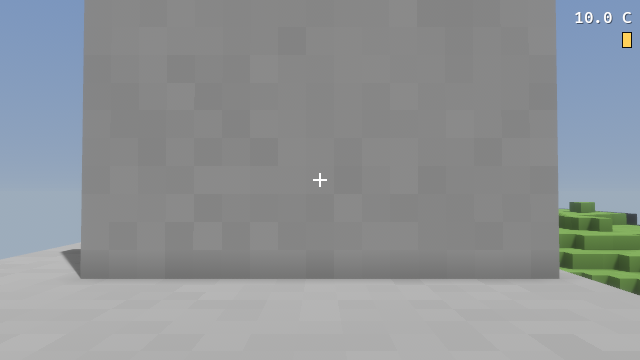
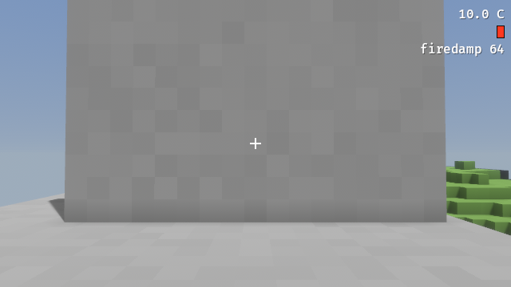
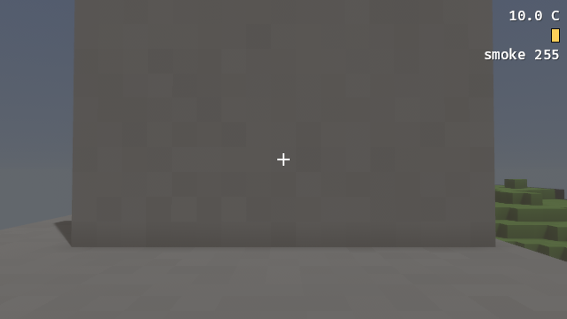
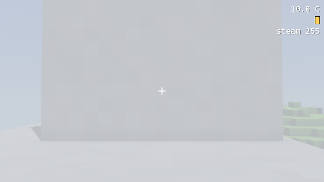

### `layer_overlay_renders`

Features: F162 (E4, passed).

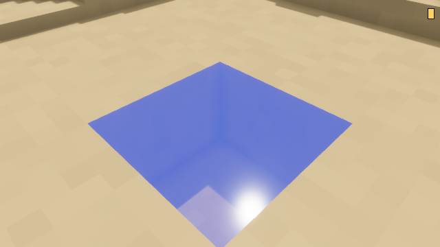
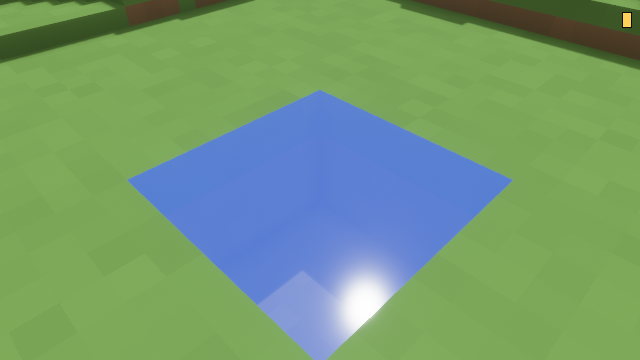

### `spoil_indicator_shows`

No feature lists this scenario: it is the screenshot check of a look-and-feel feature whose own tests are unit tests (see PROGRESS.md).

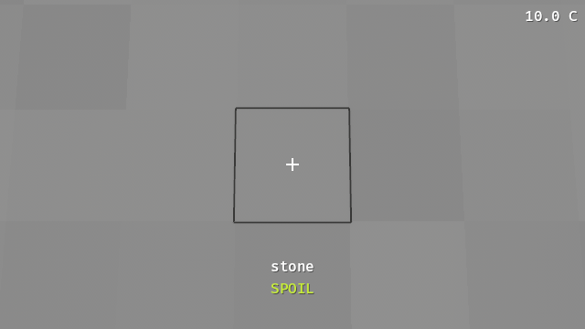
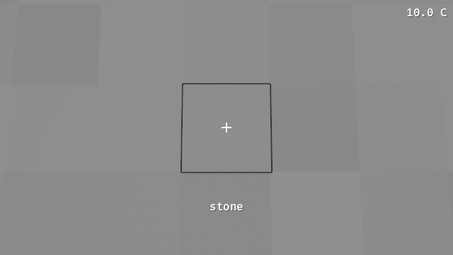

### `water_tint_shows`

No feature lists this scenario: it is the screenshot check of a look-and-feel feature whose own tests are unit tests (see PROGRESS.md).

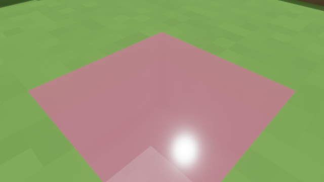
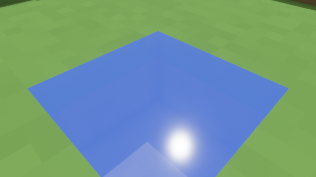

## Screenshots (Phase 2 scenarios)

Every other Phase 2 scenario's committed shots (the layer views are above).

### `firedamp_vented_by_shaft`

Features: F156 (E3b, passed).

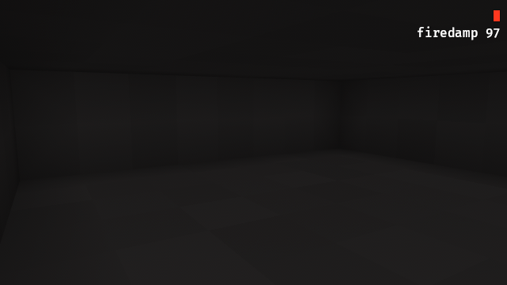


### `fireweed_takes_copper`

Features: F170 (E5, passed).

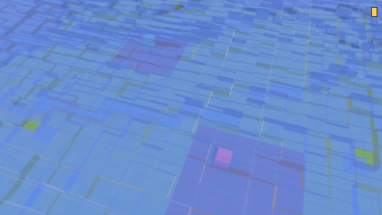

### `freeze_thaw_weathers_cut`

Features: F114 (E1, passed).


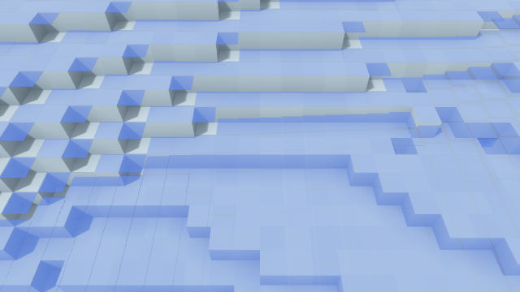

### `grass_greens_swale`

Features: F170 (E5, passed).

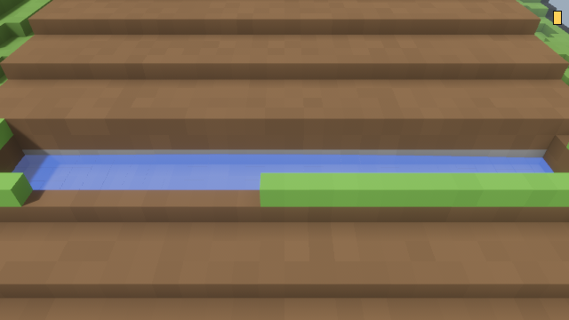

### `limestone_channel_clears`

Features: F148 (E3, passed).

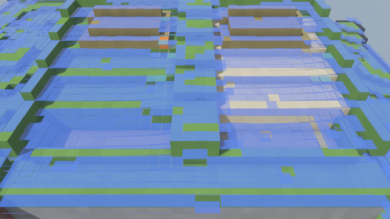

### `liquid_pass_pool`

No feature lists this scenario: it is the screenshot check of a look-and-feel feature whose own tests are unit tests (see PROGRESS.md).


### `magma_meets_water`

Features: F134 (E2b, passed).

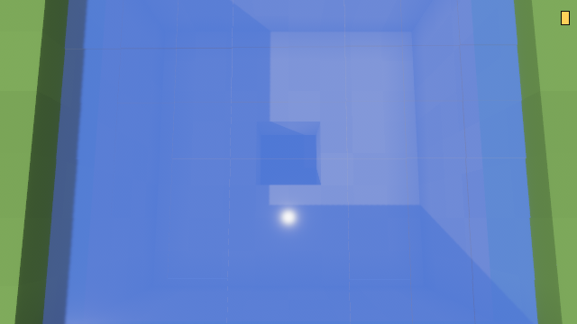

### `pit_becomes_pond`

Features: F129 (E2, passed).

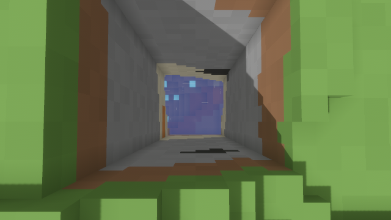

### `season_swale_fills`

Features: F128 (E2, passed), F173 (E5, passed).

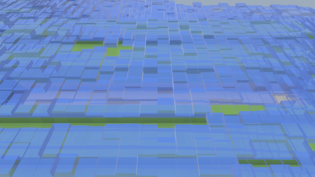
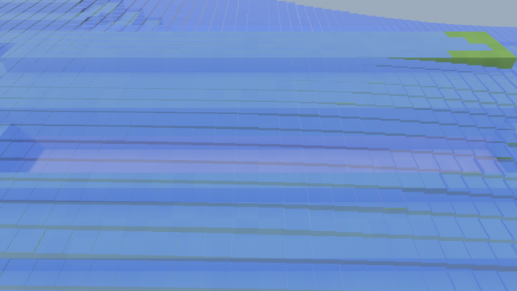

### `soak_seasons`

Features: F174 (E5, passed).

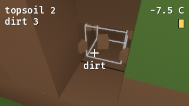
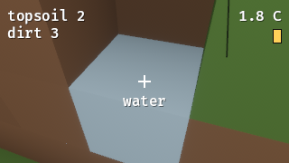
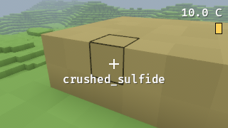
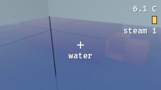
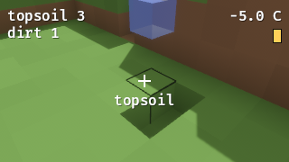
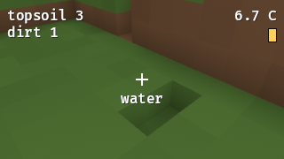

### `tailings_acidify_downslope`

Features: F147 (E3, passed).

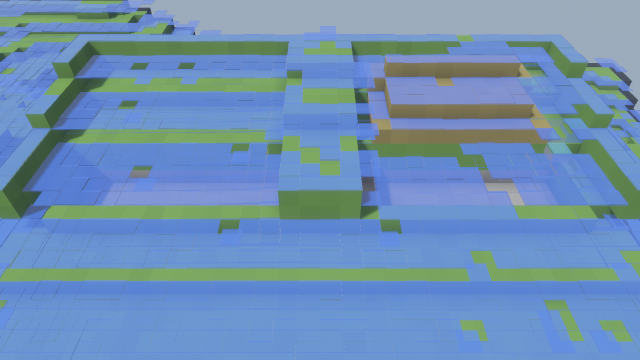

### `tailings_kill_moss`

Features: F171 (E5, passed).

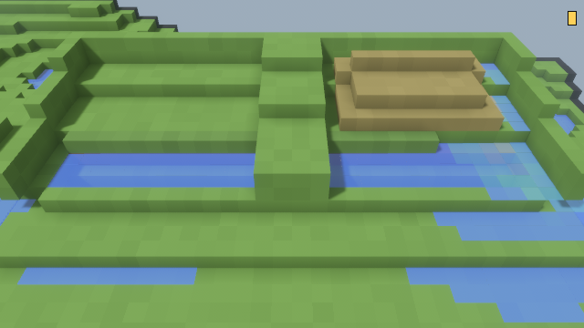

## Phase 2 performance (SAD-P2 §13)

Criterion benches of the season tick, in `crates/rmc_eco/benches/`. Run them with:

```
cargo bench -p rmc_eco
```

The bench bodies are plain functions in `rmc_eco::bench_support`. `tests/benches_run_once.rs` runs each once on a tiny generated world (1 × 2 × 1 chunks) as part of `cargo test`. Its `benches_declared` test checks that every bench is declared, times its `bench_support` function and has a row below.

The world is the default Phase 2 world: 4 × 2 × 4 chunks (128 × 64 × 128 cells, 1 M cells), seed 1 (the game's default), generated from the shipped `assets/` with every Phase 2 worldgen step. `bench_support::install` prepares it for seasons the way the host does: displacement rules, every water and gas holder in its sweep's active set, and a fresh `Activity`.

### Bench results

#### After F173 (performance pass)

Measured 2026-10-22 (F173), on the final F173 code, on the same machine and toolchain as below. An earlier run that night was starved by the OS and stopped: every process got about 4% of a core while the machine sat idle. This run came after the throttling ended.

| Bench | Time | §13 target | Status |
|---|---|---|---|
| `tick_first` | 3.03 s [3.01, 3.05] | < 5 s | met |
| `tick_quiet` | 751 ms [739, 784] (criterion slope); mean 859 ms [755, 985] | < 1 s | met once settled (see notes) |
| `water_sweep_world` | 35.7 ms [35.4, 36.2] | none | recorded |
| `chem_transport_world` | 552 ms [545, 563] | none | recorded |

What changed (F173):
- **Chunk map hashing.** The world's chunk map and the surface-column map used SipHash. Every cell read hashes a chunk position, so they now use a fixed Fx-style multiply-rotate hasher (`rmc_world::fasthash::PosMap`). Map iteration order never reaches output (rule 4: output iterates `iter_chunks_sorted`). This alone took the quiet tick from 6.5 s to about 3.5 s.
- **Settled water cells (§7.9 activity for the flow sweeps).** In the generated world about 135 k saturated limestone aquifer cells and 20 k full water cells sit in the water sweep's active set and are visited by all 64 flow sweeps a season, mostly moving nothing. A water or porous cell whose visit moved nothing is now marked settled (`Chunk::water_settled`). The sweep skips it until it or a face neighbor changes material or moisture, which `World` tracks on every write path (`apply`, `apply_delta`, `insert_chunk`, eco snapshots, `eco_set`, `eco_put_layer`). A visit reads only those 7 cells, so a skipped visit is exactly one that would have moved nothing. Results are bit-identical: `water::tests::settled_cells_skipped_without_changing_results` compares world hash, move logs and ledgers with and without skipping after every sweep, and `tick::tests::settling_changes_no_season_result` compares whole seasons with rain, boiling, magma and edits between them. Magma never settles (its visit depends on the iteration count). The settled sets are tied to a hash of the water pass's constants and are cleared when a pass with other constants runs.
- **Fewer chunk lookups** in the water visit (material and moisture in one lookup) and in chemistry transport (a donor with no substances is skipped).

Notes:
- `tick_quiet` ticks the same world for every iteration, and the per-iteration time falls as it settles further: samples went 1.22, 1.22, 0.91, 0.79, 0.75, 0.75, 0.74, 0.74, 0.73, 0.73 s per season. The third quiet season after `install` takes about 1.2 s; from about the fifth on, under 1 s. The criterion slope weights the later, longer samples.
- The generated aquifer never goes fully quiet. Limestone cells at moisture 21–24 (threshold 20, capacity 24) trade seepage sideways, about 7.8 k moves per flow sweep. Every chunk therefore changes every pass, and the Jacobi passes' quiet counters (§7.9) never skip a chunk. All 32 chunks are computed by every Jacobi pass of every sub-step.

#### Before F173 (F172 baseline)

Measured 2026-10-22 (F172): release (`bench` profile), Windows 11, Intel Core i9-12900KF (16 cores, 24 threads), rustc 1.99.1, criterion 0.8.2. The time is criterion's estimate with its 95% interval.

| Bench | What one iteration does | Time | §13 target | Status |
|---|---|---|---|---|
| `tick_first` | `season_tick` of season 0 (shipped spring rain 128) on a fresh copy of the generated world, after `install` | 10.9 s [10.88, 10.94] | < 5 s | missed |
| `tick_quiet` | one more `season_tick` of the quiet tables (rain 0, every row's `air_temp` = row 0's 10.0 °C) on the same world, after 2 quiet settling seasons; the activity carries over | 6.48 s [6.44, 6.51] | < 1 s | missed |
| `water_sweep_world` | one flow sweep (§7.3 B, iteration 0) over a fresh copy of the installed world | 86.9 ms [85.8, 89.0] | none | recorded |
| `chem_transport_world` | §7.6 transport replaying one sub-step's flow-sweep moves after season 0 rain, on a copy of the world those sweeps left, every cell holding 64 of every substance | 861 ms [857, 865] | none | recorded |

Notes:
- Copying the world and dropping it are outside the timed region (`iter_batched`, the routine returns the world).
- `tick_first` and `tick_quiet` use 10 samples. One iteration of `tick_first` takes about 11 s, so a run takes a few minutes.
- `chem_transport_world` is a worst case on purpose: worldgen lays no substances, so the bench sets all of them everywhere (`bench_support::add_substances`). Then every water move carries every substance.
- Both tick targets are missed by a wide margin. The quiet tick, about 6.5 s, costs more than half of the first season's tick, so most of the time goes to work that does not shrink when nothing changes. Activity tuning and the performance pass are F173. It also records the dev-profile budget (`quiet_world_tick_under_dev_budget`, < `eco_test.quiet_tick_dev_ms`).

### Other §13 targets

Measured 2026-10-22 (F173) with a throwaway release probe, not a bench.

| Metric | Target | Where it stands |
|---|---|---|
| Season tick, steady rain, 50 edits in one chunk | < 3 s | **Missed**: about 3.6–4.4 s. Shipped tables with rain overridden to 128 in every row; after 2 rainy seasons, 50 single-cell digs in chunk (1, 1, 1), then one timed season. Flow is about 2 s of it, mostly air↔water conversions through `World::eco_set` (about 394 k material changes a season); transport about 0.6 s. |
| Snapshots + remesh after a season | < 1.5 s to no dirty chunks | Not measured (host and client side). |
| Layer memory after 20 seasons | < 48 MB | Met: 5.8 MB of layers (6 127 616 bytes; `World::memory_bytes` 7 170 752) after 20 shipped seasons on the default world. |
| Dev-profile budget, one quiet season | < 60000 ms | Met: 337 ms for `tick::tests::quiet_world_tick_under_dev_budget` (a 4 × 2 × 4-chunk layered world built inside `rmc_eco`, since unit tests cannot use worldgen). It took 5015 ms before F173. |
