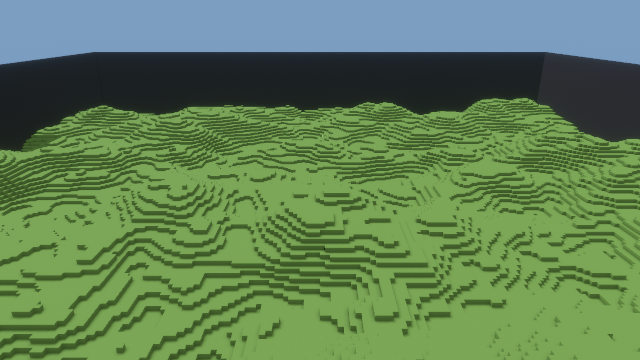
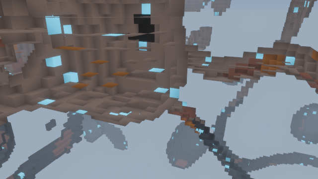
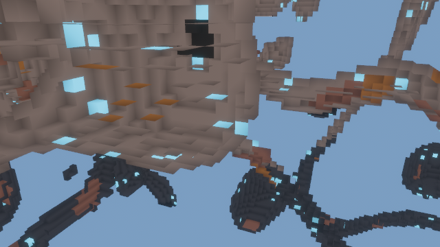

# Rust Mining Co — overnight build report

Generated 2026-10-18T13:10:54Z at commit 77c9436

## Feature status

| id | milestone | title | passes |
|---|---|---|---|
| F001 | M0 | Workspace skeleton with pinned Bevy 0.20 and all crates compiling | yes |
| F002 | M0 | No-Bevy dependency check script and CI workflow skeleton | yes |
| F003 | M0 | Coordinate conversions | yes |
| F004 | M0 | MaterialTable loading from materials.ron with tags and hash | yes |
| F005 | M0 | Scripts: smoke.sh, e2e.sh, verify-features.sh, pass-feature.sh wired and executable | yes |
| F010 | M1 | ChunkStorage Uniform/Paletted with get/set and bit-width promotion | yes |
| F011 | M1 | compact() preserves content and demotes bit width | yes |
| F012 | M1 | Chunk hash canonical across Uniform and equivalent Paletted | yes |
| F013 | M1 | World with bounds, chunk map, get_cell/is_solid, iter_chunks_sorted, world hash | yes |
| F014 | M1 | 256 uniform-stone chunks occupy under 64 MB | yes |
| F020 | M2 | Shapes with fixed iteration order and cell counts | yes |
| F021 | M2 | EditCommand Set/Remove/Paint via World::apply with deltas | yes |
| F022 | M2 | Validation: oversized and out-of-bounds commands rejected with no partial application | yes |
| F023 | M2 | Damage accumulation, break, yields, saturating, cleared by Set | yes |
| F024 | M2 | Determinism: same command sequence yields identical world hash (proptest 1000) | yes |
| F025 | M2 | apply_delta with revision check and insert_chunk | yes |
| F026 | M2 | Voxel raycast (Amanatides–Woo) | yes |
| F027 | M2 | Save format: header + zstd/postcard chunks; round trip hash identical; mismatch fails | yes |
| F030 | M3 | Protocol messages with postcard round trip for every variant | yes |
| F031 | M3 | Transport trait and ChannelTransport | yes |
| F032 | M3 | Host::tick: Hello/Welcome, hash mismatch rejection, snapshots on join, edits applied in order | yes |
| F033 | M3 | Replica fed only by ServerMsg stays hash-identical over 10,000 random edits | yes |
| F034 | M3 | RequestChunk repairs a revision gap; inventories tracked per player | yes |
| F035 | M3 | Host thread wakes on message arrival; SaveRequest handled | yes |
| F040 | M4 | GenParams from worldgen.ron, seeded fastnoise-lite layers, surface + strata | yes |
| F041 | M4 | Caves and worm tunnels, suppressed near surface | yes |
| F042 | M4 | Ores only in stone-tagged cells within depth ranges | yes |
| F043 | M4 | Glowcrystal on cave walls using 34³ border evaluation | yes |
| F044 | M4 | Bedrock shell and border continuity across all faces | yes |
| F045 | M4 | Parallel generation of 256 chunks: under 10 s in dev profile (3 s target measured by bench at M8) | yes |
| F050 | M5 | rmc_testkit TestApp: headless app, manual time, in-process synchronous host, step() | yes |
| F051 | M5 | TestApp screenshot via Screenshot::image and ScreenshotCaptured observer | yes |
| F052 | M5 | Input injection: press/release/hold/look/click as Bevy messages | yes |
| F053 | M5 | Replica resource and ServerMsg handlers with dirty-neighbor marking | yes |
| F054 | M5 | GreedyMesher with AO in merge key | yes |
| F055 | M5 | Async mesh pipeline with revision discard, budgets, nearest-first, MeshStats resource | yes |
| F056 | M5 | Rendering: StandardMaterial with vertex colors, lighting, bloom, camera | yes |
| F057 | M5 | Fly camera (noclip) with keyboard/mouse; moves through solid cells | yes |
| F058 | M5 | Emissive via ExtendedMaterial reading color alpha (optional; record if skipped) | yes |
| F060 | M6 | Kinematic controller: swept AABB collision, gravity, walk | yes |
| F061 | M6 | Jump and one-cell auto step-up | **no** |
| F062 | M6 | FixedUpdate at 60 Hz with render interpolation | **no** |
| F063 | M6 | E2E: walk_and_jump and step_up through injected input | **no** |
| F064 | M6 | Pickaxe: tools.ron profile, raycast targeting, swing interval, Damage edits, PlayerState at 20 Hz | **no** |
| F065 | M6 | HUD with HudState resource: crosshair, target outline, material name, damage progress, inventory | **no** |
| F066 | M6 | E2E: dig_cell_visible and latency_dig | **no** |
| F067 | M6 | E2E: dig_tunnel with TunnelBot; host/replica hash equality | **no** |
| F070 | M7 | EditorState resource with keyboard bindings and docs/CONTROLS.md | **no** |
| F071 | M7 | Brush ops through EditCommand: Set on face-normal side, Remove/Paint on hit, Box and Sphere | **no** |
| F072 | M7 | egui panel (bevy_egui + inspector): brush, stats, gizmos toggles, seed, save/load buttons | **no** |
| F073 | M7 | Gizmos: chunk bounds, targeted cell, mesh-queue state | **no** |
| F074 | M7 | E2E: place_and_climb and editor_brush_sphere | **no** |
| F075 | M7 | Save/load from the app: autosave timer, quit save, SaveRequest, CLI --save path, load on start | **no** |
| F076 | M7 | E2E: save_load_roundtrip | **no** |
| F080 | M8 | ChaosBot and soak_chaos E2E | **no** |
| F081 | M8 | Criterion benches: mesh_chunk, gen_world, host_tick_100, palette_set_get; results in docs/perf.md | **no** |
| F082 | M8 | Performance pass against §13 targets; initial-load upload burst | **no** |
| F083 | M8 | CI: Linux tests+E2E on lavapipe, Windows build+E2E on WARP, windows-release artifact | **no** |
| F084 | M8 | Playtester report and screenshot gallery | **no** |
| F085 | M8 | docs/REPORT.md via scripts/report.sh | **no** |

**40 / 60 features passing.**

## How to play (Windows)

```
git clone https://BucketHarmony@github.com/BucketHarmony/rust-mining-co.git C:\src\rust-mining-co
cd C:\src\rust-mining-co
cargo run --release -p rmc_app -- --seed 42
```

Or download the `windows-release` artifact from the latest CI run on main. Controls: see `docs/CONTROLS.md`.

## Screenshots







## Performance

(docs/perf.md not written)

## Decisions and blockers (from PROGRESS.md)

- Bevy 0.20 resolved on the first attempt: bevy =0.20.0, bevy_egui =0.43.1, bevy-inspector-egui =0.38.0 (both declare bevy_* ^0.20.0 on crates.io). The §3 fallback was not needed.
- glam pinned =0.33.12. bevy_math 0.20.0 requires glam ^0.33.2, so the SAD's "0.32" is out of date. Cargo.lock has one glam, 0.33.12. The core crates use glam directly.
- Other pins (crates.io latest on 2026-10-17): fastnoise-lite 1.1.1, rayon 1.12.0, serde 1.0.229, postcard 1.1.3, ron 0.12.2, zstd 0.14.3, crossbeam-channel 0.5.17, xxhash-rust 0.8.19 (xxh3), thiserror 2.0.21, anyhow 1.0.104, tracing 0.1.44, clap 4.6.7, image 0.25.10, image-compare 0.5.0, proptest 1.12.0, criterion 0.8.2.
--
Blockers: none.

## 2026-10-18 04:40 — F002 No-Bevy dependency check script and CI workflow skeleton — passed
Done: Hardened scripts/check-no-bevy.sh. A missing `crates/<core>` directory or a failing `cargo tree` now fails the check; before, both counted as "Bevy-free" because stderr was discarded and the loop `continue`d. On failure it lists the offending bevy crates (deduplicated, first 10). Checked both ways: it passes on the current tree (rc 0). With `bevy.workspace = true` injected into rmc_world `[dependencies]` it fails for all four core crates (rc 1), since the others reach rmc_world transitively. The same line under `[dev-dependencies]` is ignored, which is correct per `-e normal`. The manifest and Cargo.lock were restored afterwards. .github/workflows/ci.yml parses as YAML (PyYAML); jobs linux and windows.
--
- CI "End-to-end" steps (linux lavapipe, windows WARP) got `if: hashFiles('tests/e2e/tests/*.rs') != ''`. Without it, `scripts/e2e.sh` exits 101 ("no test target matches pattern `*`") until the first scenario lands at F056, and CI is red on every push. The guard lifts itself once a scenario exists. scripts/e2e.sh itself is unchanged.
- The no-Bevy check stays on `-e normal` as the SAD §4 says. Dev-dependencies and build-dependencies are not checked.
- On native Windows, jq in pass-feature.sh writes features.json with CRLF. Git normalizes it to LF on commit (warning only).
--
Blockers: none.

## 2026-10-18 05:00 — F003 Coordinate conversions — passed
Done: rmc_world::coords has constants CHUNK_SHIFT/CHUNK_SIZE/CHUNK_MASK/CHUNK_VOLUME/CELL_SIZE_M and the types CellPos(IVec3), ChunkPos(IVec3), LocalPos(UVec3), all serde. CellPos::{chunk, local, split, from_chunk_local, min_corner_m, center_m, from_meters}, ChunkPos::origin_cell, LocalPos::{index, from_index}. Chunk = arithmetic `>> 5`, local = `& 31`, index = x + z*32 + y*1024. Meters: cell * 0.5, half-open, from_meters floors.
--
- CellPos and ChunkPos implement Ord manually (IVec3 has no Ord) as lexicographic (y, z, x), which matches the local linear index and the §8.1 shape order. Every "sorted" output (iter_chunks_sorted, save, damage BTreeMap) uses this order.
- The meter conversions are the float boundary that rule 3 allows (raycast/client). Integer logic does not call them.
- SAD §5 says 0.5 m cells, so CELL_SIZE_M = 0.5.
--
Blockers: none.

## 2026-10-18 05:20 — F004 MaterialTable loading from materials.ron with tags and hash — passed
Done: rmc_world::materials has MaterialId(u16) (serde transparent, AIR = 0), Phase {Air, Solid}, MaterialDef (the SAD §6 fields, `deny_unknown_fields`), and MaterialTable with load(path), from_ron_str, from_defs, hash, id(key), get(id), with_tag(tag) (id order), has_tag(id, tag), iter, len. Validation rejects: an empty table; more than 65536 entries; id != position; id 0 not phase Air; empty or duplicate keys; empty or duplicate tags within a material; emissive that is non-finite or negative. assets/materials.ron has the 13 Phase 1 materials. rmc_world now depends on ron (already pinned in the workspace, =0.12.2).
--
- materials.ron is a bare RON list of MaterialDef with explicit `id`s. Each id must equal its index, so lookup is a Vec index and ids cannot drift silently.
- The hash is xxh3_64 over a hand-written canonical encoding: a "rmc.materials.v1" prefix, LE integers, length-prefixed strings, tags in file order, emissive as f32 bits. It does not depend on RON whitespace or comments. hash_is_stable pins a golden value (0x839f6f476eb45041) for an inline 3-material fixture, not for the shipped asset, so tuning materials.ron does not break the test. Changing the encoding on purpose means bumping the v1 prefix and the golden value in a `test-fix:` commit.
- Tags use only the SAD vocabulary: soil = topsoil/dirt/clay; stone = stone/granite/basalt; ore = coal_seam/copper_ore/iron_ore; crystal = glowcrystal; placeable = brass_plate. Bedrock and air have no tags. Ores are NOT tagged stone, so glowcrystal and ore placement (which filter on stone) never overwrite ores. Worldgen will pick specific strata/ore materials through keys in worldgen.ron (data, not code).
--
Blockers: none.

## 2026-10-18 05:40 — F005 Scripts: smoke.sh, e2e.sh, verify-features.sh, pass-feature.sh wired and executable — passed
Done: Ran and exercised the four scripts on native Windows (Git Bash); no script changes were needed for the features.json contract. All scripts are mode 100755 in git. smoke.sh: SMOKE_OK (build, tests, no-bevy; the boot_renders step is skipped until that scenario exists). `verify-features.sh F003` and `F004`: every test PASS via `--exact` with no substring fallback. A copy of the script against a scratch features.json under target/ (protected originals untouched) gave: missing test → FAIL rc 1; ambiguous filter `coords::tests` → FAIL; mod-path mismatch `tests::cell_to_chunk_negative` → PASS (substring match), as designed; a feature with one good and one missing test → rc 1. e2e specs, using temporary dummy scenarios in tests/e2e/tests (deleted afterwards, not committed): passing scenario → PASS (the other scenario binary reports 0 passed and does not interfere); panicking scenario → FAIL rc 1; unknown scenario → FAIL. pass-feature.sh refuses blocked features (F011 → "blocked by unpassed: F010").
--
- `--all-targets` in verify-features.sh is safe once criterion benches exist (F081): criterion 0.8.2's CLI accepts `--exact` and `--include-ignored`, and with a non-matching filter in test mode it runs nothing and exits 0.
- F005's stated criteria (cargo --exact, e2e entries, tested on F003) are met, so the feature was passed. The defect below is in a hook-protected file and is left for the owner rather than bypassing protect-files.sh with sed.
Next: M1 F010 (ChunkStorage Uniform/Paletted).
- OWNER ACTION (native Windows only; Linux/WSL2/CI unaffected): `scripts/verify-features.sh --quick` and `--all` report "no such feature: F001 / REGRESSION" for every id except the last. jq.exe writes CRLF to pipes, and `for id in $(jq -r ...)` keeps the `\r` (Git Bash's `read` strips it, so the single-id path used by pass-feature.sh works). Fix: add `-b` to the two `for id in $(jq -r ...)` jq calls and the `unpassed=` jq call (`jq -rb`), or pipe them through `tr -d '\r'`. Checked: `jq -rb` emits LF here. Until it is fixed, `--all` cannot print ALL_FEATURES_PASS on this box; per-id `verify-features.sh <id>` is reliable.

## 2026-10-18 06:00 — F010 ChunkStorage Uniform/Paletted with get/set and bit-width promotion — passed
--
- set returns the previous material, so later edit code (F021) can find changed cells without a second get.
- Palette lookup on set is a linear scan. Phase 1 palettes are small (the table has 13 materials). Revisit in the F082 perf pass if host_tick_100 shows it.
- set never demotes and never drops unused palette entries; compact() does that (F011). Revision and modified are not touched by ChunkStorage; World::apply owns them (F021).
--
Blockers: none new (the Windows CRLF issue in verify-features.sh --all from F005 still stands).

## 2026-10-18 06:20 — F011 compact() preserves content and demotes bit width — passed
Done: ChunkStorage::compact(&mut self) in rmc_world::chunk. Uniform is a no-op. Paletted is rebuilt in one pass over local linear index order: each used old slot gets a new slot on first appearance, unused entries are dropped, and data is repacked at bits_for(len) (smallest of 1/2/4/8/16). If only one material is left, the chunk becomes Uniform. Revision and modified are untouched, since content does not change.
--
- Compacted palette order is first appearance in local linear index order, not sorted by id and not the old palette order. The result depends only on content, so equal contents give a structurally equal ChunkStorage after compact. F012 can use that as the canonical encoding if it wants.
- A single remaining material demotes to Uniform. The SAD says "demoting bit width"; Uniform is the narrowest form, and it matches how worldgen emits single-material chunks.
- Deleted the proptest-regressions/chunk.txt seed that the deliberate todo!() failure wrote (fill=0, ops=[], undo=0). It recorded only the stub panic.
--
Blockers: none new (the Windows CRLF issue in verify-features.sh --all from F005 still stands).

## 2026-10-18 06:40 — F012 Chunk hash canonical across Uniform and equivalent Paletted — passed
Done: ChunkStorage::hash() and Chunk::hash() (which delegates) in rmc_world::chunk. The hash is xxh3_64 over the compacted form, encoded as: "rmc.chunk.v1" prefix, palette length (u32 LE), palette ids (u16 LE), bit width (u8), data words (u64 LE). Uniform encodes as a one-entry palette with 0 bits and no data words, and a Paletted chunk that compacts to one material encodes the same way. Pulled the compaction logic out of compact() into a private `compacted(palette, bits, data) -> ChunkStorage` used by both compact() and hash(). It now does two passes (remap, then write) and no longer keeps a 32768-entry slot Vec. The F010/F011 tests are unchanged and still pass.
--
- The hash covers cell contents only. Chunk.revision and Chunk.modified are not hashed: SAD §7 defines the hash over the canonical paletted encoding, and World::hash (F013) folds in positions, not revisions. Revision agreement between host and replica is apply_delta's job (F025).
- The canonical encoding reuses compact()'s first-appearance palette order, so it depends only on content. No golden value is pinned: chunk hashes are compared only between worlds in the same build (determinism, replica equivalence) and are never persisted. Changing the encoding on purpose means bumping the v1 prefix.
- hash() on a Paletted chunk allocates a compacted copy (at most 64 KiB data). That is fine for world hashing at test and handshake rates. Revisit in F082 if profiling shows it.
--
Blockers: none new (the Windows CRLF issue in verify-features.sh --all from F005 still stands).

## 2026-10-18 07:00 — F013 World with bounds, chunk map, get_cell/is_solid, iter_chunks_sorted, world hash — passed
Done: New rmc_world::world with World { chunks: HashMap<ChunkPos, Chunk>, materials: Arc<MaterialTable>, bounds: CellAabb } and WorldError::ChunkOutOfBounds. API: new(materials, bounds) (empty), bounds(), materials(), get_cell, is_solid, chunk(pos), chunk_count, iter_chunks_sorted, hash, insert_chunk. New coords::CellAabb { min, max } (inclusive like Shape::Box, serde for Welcome/save header) with PHASE1_DEFAULT = (0,0,0)..=(255,127,255) (8×4×8 = 256 chunks, also its Default), new (asserts min <= max), contains, intersects_chunk, and chunks() (every overlapping chunk in (y, z, x) order).
--
- get_cell returns None when the cell is outside the bounds OR its chunk is not resident (for example a replica before the snapshot arrives). It does not fall back to AIR. is_solid is false for None and for ids the table does not know. A chunk that straddles the bounds is resident, but its out-of-bounds cells read as None.
- Default bounds start at the origin with y up: cells 0..=255 × 0..=127 × 0..=255. The SAD gives only the size, so the origin is the conservative choice.
- insert_chunk returns Result<Option<Chunk>, WorldError>: the previous chunk, or ChunkOutOfBounds when no cell of the chunk is inside the bounds (the chunk is then not stored). The SAD lists no return type; rejecting is safer than storing unreachable chunks. It does not touch revision, modified or compaction; the caller's chunk is stored as is.
--
Blockers: none new (the Windows CRLF issue in verify-features.sh --all from F005 still stands).

## 2026-10-18 07:20 — F014 256 uniform-stone chunks occupy under 64 MB — passed
Done: ChunkStorage::heap_bytes() (palette + data Vec capacity; Uniform = 0) and World::memory_bytes() (size_of World + estimated chunk-map table + sum of chunk heap bytes). Measured: 256 uniform-stone chunks = 45,664 bytes; 256 chunks all at a 16-bit palette (worst case) = 16,954,464 bytes. Both are far under the budget.
--
- Memory is accounted, not measured with a counting global allocator. That would need `unsafe impl GlobalAlloc` (rule: deny(unsafe_code)) or a new crate. The table estimate follows std/hashbrown's SwissTable layout: buckets from capacity() (cap+1 below 7, else cap/7*8), one (ChunkPos, Chunk) entry plus one control byte per bucket, plus a 16-byte group. Vecs count capacity, not len. The shared Arc<MaterialTable> is not counted (it is not chunk storage).
- "64 MB" is read as 64,000,000 bytes, the stricter of MB and MiB.
- The SAD has no 64 MB row in §13; the budget comes from the feature title. The test also covers the 16-bit worst case, so edits cannot push a full 256-chunk world over the budget either.
--
Blockers: none new (the Windows CRLF issue in verify-features.sh --all from F005 still stands).

## 2026-10-18 07:40 — F020 Shapes with fixed iteration order and cell counts — passed
Done: New rmc_world::shape with Shape::{Cell(CellPos), Box { min, max } (inclusive), Sphere { center, radius: u16 } (dx²+dy²+dz² <= r²)}. It derives serde for the protocol. API: cells() -> ShapeCells, cell_count() -> u64, aabb() -> Option<CellAabb>. ShapeCells is a FusedIterator over x-runs per (y, z) row, so cells come out in ascending (y, z, x) order (= CellPos Ord). It never scans empty rows. Sphere row spans use integer square roots (u64::isqrt); the module has no floats.
--
- An empty Box (min > max on any axis) is allowed and yields nothing: count 0, aabb None. Shape is wire data, so it does not panic like CellAabb::new. F022 can reject it as "entirely outside".
- Coordinates are i64 inside the iterator. Cells that would leave the i32 range are skipped (they are outside every world). cell_count() and aabb() describe the ideal shape (aabb clamped to i32), so cells().count() <= cell_count(). Validation therefore errs toward rejecting.
- cell_count() is computed, not iterated: boxes are a saturating product, spheres are a sum of isqrt row spans (O(r²)). For a radius of up to 65535 that is too slow on a hostile command. F022 should reject big radii before counting (r >= 20 already exceeds MAX_EDIT_CELLS: 33,401 > 32,768) or check the aabb volume first.
--
Blockers: none new (the Windows CRLF issue in verify-features.sh --all from F005 still stands).

## 2026-10-18 08:00 — F021 EditCommand Set/Remove/Paint via World::apply with deltas — passed
Done: New rmc_world::edit with PlayerId(u32), CommandId { issuer, seq: u32 }, EditOp::{Set, Remove, Damage, Paint}, EditCommand (all serde, like Shape), RejectReason, EditStatus, ChunkDelta::{Cells, Full} (with pos()/revision()), EditResult and FULL_DELTA_THRESHOLD = 4096. World::apply(&EditCommand) -> EditResult in world.rs: it checks the op against the material table, then visits the shape's cells in (y, z, x) order. A cell is skipped when it is outside the bounds, its chunk is not resident, the op does not apply to its material (Remove: def not diggable; Paint: def not Solid), or it already holds the target. Changes are grouped per chunk in a BTreeMap, so deltas come out ascending by ChunkPos. Each changed chunk gets exactly one revision bump per command and modified = true. More than 4096 changed cells → the chunk is compacted and sent as Full (a clone of the world's compacted storage); otherwise Cells, sorted by local index.
--
- Set/Paint with a MaterialId that is not in the table rejects the whole command (RejectReason::UnknownMaterial). The SAD is silent; an unknown id in a replica would break meshing and collision.
- EditOp::Damage is rejected with RejectReason::Unsupported until F023 adds the damage map. F023 should delete that variant once Damage is implemented.
- Paint checks only phase (Solid), not diggable, so it repaints bedrock. Set overwrites anything, bedrock included. This follows SAD §8.2 literally: the diggable check is only for Damage/Remove.
--
Blockers: none new (the Windows CRLF issue in verify-features.sh --all from F005 still stands).

## 2026-10-18 08:20 — F022 Validation: oversized and out-of-bounds commands rejected with no partial application — passed
Done: edit::MAX_EDIT_CELLS = 32,768 and RejectReason::{TooManyCells, OutsideBounds}. New pub World::validate(&EditCommand) -> Result<(), RejectReason> runs three checks in order: the op (unknown material / unsupported Damage, from F021), then size, then bounds. World::apply calls it before touching any cell, so a rejected command changes no cell, revision or `modified` flag and returns no deltas or yields. New Shape::cell_count_exceeds(limit): boxes use the saturating product, spheres sum row lengths and stop once past the limit. That is O(limit) at any radius (u16::MAX is rejected in microseconds). cell_count() and cell_count_exceeds() share a private sphere_row_lengths iterator.
--
- "Exceeds MAX_EDIT_CELLS" means count > 32,768; exactly 32,768 is allowed. The count is the shape's ideal cell count (cell_count semantics), including cells outside the bounds or outside the i32 range. A huge shape that barely touches the world is still rejected.
- "Entirely outside bounds" is tested per cell (some cell of the shape is inside the bounds), not by AABB overlap, so a sphere whose box clips a corner but whose cells do not is rejected. The scan happens after the size check, so it visits at most 32,768 cells and stops at the first cell inside. An empty Box (min > max) counts as entirely outside. Whether a chunk is resident does not matter.
- Check order: op, then size, then bounds. Each test command fails only one check, so the order only decides which reason is reported. Size goes before bounds because the bounds scan is only cheap on a bounded shape.
--
Blockers: none new (the Windows CRLF issue in verify-features.sh --all from F005 still stands).

## 2026-10-18 08:40 — F023 Damage accumulation, break, yields, saturating, cleared by Set — passed
Done: New rmc_world::damage with DamageMap (BTreeMap<CellPos, u16>; pub get/len/is_empty/iter, crate-private hit/clear/clear_chunk). World gains the host-only `damage` field (SAD §7) and a pub damage() accessor. World::apply now handles EditOp::Damage(dmg). A cell whose material is unknown or not diggable is skipped. Otherwise its damage goes up by a saturating add. When the total reaches the hardness, the cell becomes air, its entry is removed, and the material's yield_count is added to EditResult.yields, which is aggregated per material and sorted ascending by MaterialId. Damage without a break changes no cell, revision or `modified` flag and produces no delta. Breaks go through the same delta path as other ops, so more than 4096 breaks in one chunk give a Full delta. Set/Paint/Remove clear the damage on every cell they apply to. RejectReason::Unsupported is deleted, as F022 asked.
--
- Set/Paint/Remove clear damage on every cell the op applies to (EditOp::target is Some), even when the material does not change. Example: Set(stone) on damaged stone gives no delta but resets the damage. SAD §7 says "on a cell", not "on a changed cell". Cells the op skips (Paint on air, Remove on bedrock) keep their damage; those cells cannot hold damage anyway.
- Damage applies to cells that are diggable. Phase is not checked, following §8.2 literally. Unknown ids count as not diggable.
- Hardness 0 breaks on any hit, even Damage(0) (0 >= 0, "0 = instant"). Damage(0) is accepted. On a harder cell it adds nothing and stores no entry; the map never holds a 0 entry.
--
Blockers: none new (the Windows CRLF issue in verify-features.sh --all from F005 still stands).

## 2026-10-18 09:00 — F024 Determinism: same command sequence yields identical world hash (proptest 1000) — passed
Done: Test-only feature. Added edit::tests::determinism_proptest. Each case builds two worlds with equal contents: 6 chunks (3 × 1 × 2; negative coordinates; the x = 1 column cut by the max face), each 90% likely to be resident, with a random fill and up to 5 scattered cells over all 13 materials. World `b` inserts its chunks in shuffled order (a separately seeded HashMap) and holds structurally different storage: an extra palette entry, or Paletted where `a` is Uniform. Both get the same 1–31 random commands, each repeated 1–16 times so damage piles up to breaks. Ops: Set/Remove/Damage/Paint over every material id plus one unknown id, with damage values 0, 1..=40 and any u16. Shapes: cells, boxes (some empty), spheres r < 8, 32 × 8 × 32 boxes that cross FULL_DELTA_THRESHOLD, and oversized spheres (rejected). Positions extend a few cells past every face. Checks after every command: identical EditResult (status, deltas including Full storage, yields), deltas ascending by chunk, yields ascending by material. A replica gets only the deltas, through a revision-checked replay. At the end: equal world hash on a, b and the replica, equal (revision, modified) per chunk on a and b, equal revisions on the replica, and equal damage maps on a and b. The test helper replay() now wraps a new replay_in_place(); behaviour is unchanged.
--
- F021–F023 already made apply deterministic (BTreeMap per chunk, fixed shape order, sorted yields, canonical compact), so the test passed on its first run, and no product code changed. Proof that it can fail: temporarily switching World::apply's `changed` map to a HashMap made it fail on the first case (deltas in a different order between a and b). The change was reverted.
- The replica is compared on hash and revisions, not `modified`. `modified` is host save state and deltas do not carry it. F025's apply_delta will set its own replica rules.
- Full delta storage can be compared structurally between a and b even though their storage started out structurally different, because compact() is canonical (first-appearance palette, smallest bit width).
--
Blockers: none new (the Windows CRLF issue in verify-features.sh --all from F005 still stands).

## 2026-10-18 09:20 — F025 apply_delta with revision check and insert_chunk — passed
Done: New World::apply_delta(&ChunkDelta) -> Result<(), DeltaError> and DeltaError::{OutOfBounds, NotResident, RevisionGap { pos, local, got }, BadIndex, UnknownMaterial, MalformedStorage} (thiserror, Clone). Cells: the chunk must be in bounds and resident, delta revision == local + 1 (checked_add, so a chunk at u64::MAX takes no Cells delta), every index < 32,768 and every material in the table. All checks run before any write, so a refused delta changes nothing. Changes are then written in order (a later change to the same cell wins). Full: the storage must pass the new ChunkStorage::is_well_formed() (allowed bit width, exact data length, non-empty palette that fits the width, every cell slot inside the palette); it is cloned and compacted, every material it uses must be known, and it then replaces the chunk. Both kinds set the chunk's revision to the delta's and modified = true, and clear damage on the cells they overwrite (Cells: each written cell; Full: the whole chunk). insert_chunk is unchanged (F013). The edit.rs test helper replay_in_place now goes through apply_delta. It keeps its own "revision == local + 1" assertion for both kinds, so those tests are stronger, not weaker.
--
- Full replaces unconditionally, whatever the local revision (SAD §7: "Full replaces"), including an older revision. In-order transport means a stale Full does not occur; accepting a newer one means a Full delta also repairs a gap.
- Full on an in-bounds chunk that is not resident inserts it (the delta is the complete chunk). Cells on a non-resident chunk is NotResident, not a gap; the client can treat both by sending RequestChunk.
- The replica sets modified = true on every applied delta, matching the host (which marks every changed chunk modified). Equivalence tests can therefore compare `modified` too.
--
Blockers: none new (the Windows CRLF issue in verify-features.sh --all from F005 still stands).

## 2026-10-18 09:40 — F026 Voxel raycast (Amanatides–Woo) — passed
Done: New rmc_world::raycast with `Hit { cell: CellPos, face_normal: IVec3, distance: f32 }` and `raycast(&World, origin: Vec3, dir: Vec3, max_dist: f32) -> Option<Hit>`, re-exported at the crate root as `rmc_world::raycast` / `rmc_world::Hit` (SAD §11.5). The ray is normalized and walked in f64 meters. First it is slab-clipped against the world bounds box, so the walk covers at most [max(0, t_enter), min(max_dist, t_exit)]. Then a standard Amanatides–Woo walk runs: t_max for the stepped axis is recomputed from the cell boundary each step (no drift), and cells are i64 internally, so nothing overflows near the i32 edge. "Solid" is World::is_solid (phase Solid). Cells outside the bounds or in non-resident chunks never block.
--
- Starting inside a solid cell returns that cell with distance 0 and face_normal IVec3::ZERO, even with max_dist 0. The editor's "Set on the face-normal side" then targets the same cell; F071 can ignore Set on a zero normal if it wants to.
- Reach is inclusive: a cell entered at exactly max_dist is hit.
- face_normal points out of the entered face (−step on the last stepped axis), so `hit.cell + face_normal` is the cell in front. Distance is meters from the given origin, even when the walk starts at the bounds entry point.
--
Blockers: none new (the Windows CRLF issue in verify-features.sh --all from F005 still stands).

## 2026-10-18 10:00 — F027 Save format: header + zstd/postcard chunks; round trip hash identical; mismatch fails — passed
Done: New rmc_world::save (SAD §10). SaveHeader { format_version, seed, bounds, material_hash, gen_params_hash, noise_crate_version } (serde, written as pretty RON to header.ron; SaveHeader::new stamps SAVE_FORMAT_VERSION = 1). SavedChunk { pos, revision, storage } encodes exactly like the tuple (ChunkPos, u64, ChunkStorage); chunks.bin = zstd(level 3, postcard(Vec<SavedChunk>)). API: snapshot(&World) gives the modified chunks in ChunkPos order with compacted storage; write(dir, header, &[SavedChunk]) writes each file to `<name>.tmp` and renames it into place (chunks first, then header); save(dir, header, &World) = snapshot + write and returns the chunk count; read_header, read_chunks (both strictly ascending, no duplicates); load(dir, expected, generate: FnOnce() -> World). Load reads the header and compares it with `expected` field by field, reads and decodes the chunks, calls `generate` only after both succeed, checks that the generated world's bounds and material hash match the header, then applies each saved chunk as ChunkDelta::Full through World::apply_delta. That reuses F025's checks (bounds, well-formed storage, known materials, compaction), restores the saved revision, marks the chunk modified, and leaves damage empty. SaveError (thiserror): Io, HeaderParse, HeaderEncode, HeaderMismatch { field: HeaderField, expected, found }, WorldMismatch(HeaderField), Decompress, ChunkDecode, ChunkEncode, UnsortedChunks, BadChunk(DeltaError). ChunkStorage now derives Serialize/Deserialize. rmc_world depends on postcard and zstd (workspace pins from M0).
--
- rmc_world cannot depend on rmc_worldgen, so load takes a `generate` closure. The host (F032+) passes `|| generate_world(seed, params, table)`. The noise crate version and gen params hash are plain header values that the caller fills in (worldgen should expose a constant for the fastnoise-lite version).
- The header must match exactly on every field, format version included; there is no migration in Phase 1. Fields are compared in declaration order and the first difference is reported.
- Load also checks the generated world against the header (bounds, material hash), and save refuses a header that does not describe the world. Either mismatch would produce a world or save that silently disagrees with its header.
--
Blockers: none new (the Windows CRLF issue in verify-features.sh --all from F005 still stands).

## 2026-10-18 10:20 — F030 Protocol messages with postcard round trip for every variant — passed
Done: rmc_protocol now has msg (ClientMsg, ServerMsg exactly as SAD §8.4, plus PROTOCOL_VERSION = 1) and codec (encode_client/decode_client/encode_server/decode_server, CodecError::{Encode, Decode, TrailingBytes, MalformedStorage}, thiserror). Encoding is postcard::to_stdvec. Decoding uses postcard::take_from_bytes and refuses trailing bytes, so a buffer holds exactly one message. decode_server also checks every chunk storage it carries (ChunkSnapshot, and Full deltas inside Applied) with ChunkStorage::is_well_formed and returns MalformedStorage otherwise. In rmc_world, RejectReason, EditStatus, ChunkDelta and EditResult now derive Serialize/Deserialize (derives only, no behaviour change).
--
- Server-side storage validation lives in decode_server. World::insert_chunk does not check storage, so without it a malformed ChunkSnapshot would panic later in get/compact on the client. apply_delta still runs its own checks, so Full deltas are checked twice, which is cheap and harmless. decode_client does no semantic checks: the host validates edits (§8.2), and a NaN PlayerState is the host's concern (raycast already returns None on non-finite input).
- Strict framing: trailing bytes are an error, not ignored. Framing (length prefixes) belongs to the transport; ChannelTransport (F031) passes typed messages and can skip the codec entirely, while a network transport would use it.
- The wire carries storage exactly as sent, with no compaction on decode. Receivers compact where needed (apply_delta does).
--
Blockers: none new (the Windows CRLF issue in verify-features.sh --all from F005 still stands).

## 2026-10-18 10:40 — F031 Transport trait and ChannelTransport — passed
Done: New rmc_host::transport (SAD §8.5), re-exported at the crate root. `Transport: Send` has exactly the SAD's two methods: `recv(&mut self) -> Vec<(PlayerId, ClientMsg)>` (non-blocking; everything that arrived since the last call, in arrival order) and `send(&mut self, to: Recipient, msg: ServerMsg)`. `Recipient { All, One(PlayerId), AllExcept(PlayerId) }` with `includes(player)`. `ChannelTransport` (crossbeam, unbounded) has one shared inbound channel and a BTreeMap<PlayerId, Sender<ServerMsg>> of outbound channels. `connect()` returns a `ClientEndpoint { player(), send(ClientMsg) -> Result<(), Disconnected>, try_recv(), drain() }`; `players()` lists connected ids ascending. Messages are passed typed, with no encoding. rmc_host gets glam as a dev-dependency (test messages build Vec3/IVec3).
--
- `Recipient` is not spelled out in the SAD. I used All / One / AllExcept: One for Welcome, Rejected, snapshots on join and Inventory, All for Applied, and AllExcept reserved for the co-op PlayerStates relay.
- The transport assigns PlayerIds (1, 2, 3, ..., never reused) at connect and tags every inbound message with the endpoint's id, so a client cannot send as another player. PlayerId(0) is never assigned. Host (F032) sends this id in Welcome and should treat it, not EditCommand.issuer, as the sender.
- Broadcasts go to clients in ascending PlayerId order (BTreeMap, rule 4). All clients share one inbound channel, so recv gives a single global arrival order, which F032's "edits applied in arrival order" needs.
--
Blockers: none new (the Windows CRLF issue in verify-features.sh --all from F005 still stands).

## 2026-10-18 11:00 — F032 Host::tick: Hello/Welcome, hash mismatch rejection, snapshots on join, edits applied in order — passed
Done: New rmc_host::host (SAD §8.5), re-exported as rmc_host::{Host, HostConfig}. `HostConfig { seed, gen_params_hash }` carries the Welcome fields the World does not hold. `Host::new(world, config, Box<dyn Transport>)`, `tick()`, `world()`, plus `is_joined(player)`. tick drains `transport.recv()` and handles each message in arrival order, sending replies as it goes, so outbound order follows inbound order. Hello: protocol != PROTOCOL_VERSION or material_hash != world.materials().hash() → one `Rejected { reason }` to that player (the reason names protocol or material table, with both values). A match → `Welcome { player, seed, bounds, gen_params_hash }`, then one `ChunkSnapshot { pos, revision, storage }` per resident chunk in iter_chunks_sorted order, and the player is joined. Edit: issuer and id.issuer are replaced by the transport's sender id, then World::apply. An Applied result goes to every joined player; a Rejected result goes only to its issuer. PlayerState is ignored (no one to relay to in single player); RequestChunk and SaveRequest are logged with debug! and left to F034/F035.
--
- Results and deltas go only to joined players, sent One(p) per joined player in ascending id order, not Recipient::All: a connected client that has not joined (or was rejected) holds no snapshots, so deltas would be meaningless or break its replica.
- A rejected EditResult goes only to its issuer. Nobody else's replica needs it, and its issuer still learns why (the client can use the CommandId).
- The sender id from the transport is authoritative: the host overwrites EditCommand.issuer and CommandId.issuer before applying (F031's decision).
--
Blockers: none new (the Windows CRLF issue in verify-features.sh --all from F005 still stands).

## 2026-10-18 11:20 — F033 Replica fed only by ServerMsg stays hash-identical over 10,000 random edits — passed
Done: New rmc_host::replica, re-exported as rmc_host::{Replica, ReplicaError}. `Replica::new(Arc<MaterialTable>)` is a Bevy-free client world built only from ServerMsgs. `hello()` gives the Hello to send. `handle(ServerMsg) -> Result<(), ReplicaError>`: Welcome creates an empty World with the host's bounds and records the player id (a second Welcome starts over); Rejected records the reason while unjoined and is ignored after joining; ChunkSnapshot checks is_well_formed and that every palette entry is in the table, then insert_chunk with the host's revision; Applied runs every delta through apply_delta, applying the rest when one is refused and reporting the refused ones together. Inventory, PlayerStates and Saved do not touch the world. Accessors: player(), world(), rejected(). ReplicaError (thiserror): NotJoined, SnapshotOutOfBounds, MalformedSnapshot, UnknownSnapshotMaterial, Deltas(Vec<DeltaError>).
--
- The replica lives in rmc_host (the test path names it there) as a public, Bevy-free type. rmc_client does not depend on rmc_host, so F053's Bevy Replica resource will be separate; it can mirror this logic. The testkit or bots may use this one.
- No gap repair yet: a refused delta is only reported (ReplicaError::Deltas). F034 adds the SAD §8.5 rule (send RequestChunk, ignore that chunk's deltas until the snapshot) and the host's RequestChunk handler.
- Snapshot storage is validated (well formed, palette materials known) because insert_chunk trusts its input and a bad palette would panic later. This is the same reasoning F025 and F030 used. Unknown palette entries are refused even when unused, since a correct host with the same table (checked at Hello) never sends them.
--
Blockers: none new (the Windows CRLF issue in verify-features.sh --all from F005 still stands).

## 2026-10-18 11:40 — F034 RequestChunk repairs a revision gap; inventories tracked per player — passed
Done: New rmc_world::inventory::Inventory (re-exported as rmc_world::Inventory): per-material counts in a BTreeMap, add/add_all saturate at u32::MAX, zero counts are not stored (so equal counts compare equal), items() ascending by id, from_items sums repeats. Host: `inventories: BTreeMap<PlayerId, Inventory>`, an empty one created at join; `Host::inventory(player) -> Option<&Inventory>` (None until joined). After an applied edit, the result goes to every joined player as before, and if it has yields, the sender's inventory grows and the sender alone then gets `Inventory { items }` with its new totals. `RequestChunk(pos)` from a joined player gets a `ChunkSnapshot` of that chunk (current revision and storage), sent to the requester only; a non-resident or out-of-bounds chunk is ignored with debug!. Replica: a delta whose revision is more than one ahead of the chunk (a gap) queues `RequestChunk(pos)` and adds pos to a wait set. Deltas for a waited-for chunk are ignored until its snapshot arrives, which ends the wait. New accessors: take_requests() (drains the queue), is_awaiting(pos), inventory() (replaced by each Inventory message). Welcome clears the wait set, the queue and the inventory.
--
- Only a forward gap (delta revision > local + 1) is repaired. A stale delta (revision <= local) means a duplicate or old message; the replica already holds a newer chunk, so it is refused and reported as before (ReplicaError::Deltas) with no request. This keeps F033's handle_edge_cases expectations.
- A gap is not an error: handle returns Ok and the repair runs. NotResident, unknown-material and other delta errors are still reported, not repaired (the SAD names only revision gaps).
- While a chunk is waited for, Full deltas for it are ignored too, even though Full is not revision-checked. The snapshot follows anyway, and this keeps an older Full from overwriting newer state.
--
Blockers: none new (the Windows CRLF issue in verify-features.sh --all from F005 still stands).

## 2026-10-18 12:00 — F035 Host thread wakes on message arrival; SaveRequest handled — passed
Done: New rmc_host::thread (SAD §8.5), re-exported as rmc_host::{spawn_host_thread, HostHandle}. `spawn_host_thread(host, hz)` moves the Host onto a thread named rmc-host that ticks every 1/hz s, and also as soon as a message arrives. It uses crossbeam `select!` over a stop channel, the transport's wake channel and a timeout to the next deadline. Wake tokens are drained before each tick reads messages, and the deadline is reset after every tick. `HostHandle::stop()` stops the thread right away (it does not wait for the timer) and returns the Host. Dropping the handle stops and joins too. hz = 0 panics. Transport gets one provided method, `wake_signal(&self) -> Option<Receiver<()>>` (default None, which means timer only). ChannelTransport has a bounded(1) wake channel; `ClientEndpoint::send` pushes the message and then `try_send`s a token, so tokens coalesce and every message lands before its token. New `ClientEndpoint::recv_timeout(Duration)`. `Host::wake_signal()` passes it through. SaveRequest: `SaveConfig { dir, noise_crate_version }` is set with `Host::with_save(config)`. `Host::save() -> Result<usize, HostSaveError>` builds a SaveHeader from HostConfig (seed, gen params hash), the world's bounds and material hash, and the configured noise version, then calls rmc_world::save::save (snapshot of modified chunks, then temp-file and rename write). A SaveRequest from a joined player saves right then, in arrival order, and sends `Saved { ok, path: dir }` to the requester only. A failure logs warn! and sends ok = false. A host without SaveConfig answers `Saved { ok: false, path: "" }`. HostSaveError (thiserror): NoSaveDir, Save(SaveError).
--
- The wake path is a provided method on Transport (`wake_signal`, default None) rather than a change to spawn_host_thread's signature, which stays as the SAD gives it. A network transport can offer the same signal later; one without it falls back to timer ticks.
- The wake channel has capacity 1 and the endpoint sends the token after the message. The thread drains tokens before tick() calls recv(), so a message is never stranded waiting for the timer. At worst a wake finds nothing to do, which is harmless.
- Save runs synchronously inside the tick, on the host thread, from the world as it is at that point in the message order. Edits that arrive after the request in the same tick are not in it. Moving the file write off the host thread (save::snapshot and save::write are already split) can come later if save time shows up in tick latency.
--
Blockers: none new (the Windows CRLF issue in verify-features.sh --all from F005 still stands).

## 2026-10-18 12:20 — F040 GenParams from worldgen.ron, seeded fastnoise-lite layers, surface + strata — passed
Done: rmc_worldgen now has params, noise and gen (re-exported: Generator, generate_chunk, GenParams, GenError, NOISE_CRATE_VERSION = "fastnoise-lite 1.1.1"). New assets/worldgen.ron. `GenParams { surface { base_height, amplitude, noise }, soil: [SoilLayer { material, min_cells, max_cells, noise }], strata { boundary_amplitude, boundary_noise, layers: [Stratum { material, until_depth: Option }] } }`, with `NoiseParams { frequency (per meter), octaves }`. load/from_ron_str validate ranges and order (finite frequency > 0, octaves 1..=8, cells 0..=2^20, soil min <= max, strata non-empty, increasing boundaries, only the last one None). `GenParams::hash()` is xxh3 over "rmc.genparams.v1" + the postcard encoding, so RON formatting does not affect it. noise: `layer_seed(seed, layer)` = xxh3("rmc.noise.v1", full u64 seed, u32 layer id) truncated to i32. `NoiseLayer` wraps FastNoiseLite (OpenSimplex2, FBm), sampled at the cell column's min corner in meters, with `offset_2d` (whole offset within ±amplitude) and `pick_2d` (whole value in min..=max). Layer ids: surface 0x1, soil 0x100+i, strata boundaries 0x200+i. gen: `Generator::new(seed, &params, &table)` validates, resolves material keys (soil layers need the "soil" tag, strata "stone"; GenError::UnknownMaterial/MissingTag) and seeds the layers. `generate(pos)` builds a 34³ `Volume` (chunk plus a 1-cell border; `base_volume(pos)` is steps 1–2), writes the inner 32³ and compacts it. Revision 0, not modified. `surface_height(x, z)` is the y of the topmost solid cell. `generate_chunk(seed, pos, &params, &table)` is the SAD's pure entry point; it builds a Generator for that one chunk and panics on params that do not fit the table. Per column: surface = base_height + offset; soil layers top down, each min..=max cells from its own noise; then strata by depth under the surface cell, with each boundary at until_depth + its own 2D noise offset (±boundary_amplitude). Shipped values: surface 96 ± 10 (world y 0..127), topsoil 1–2, dirt 3–5, stone to depth 24 ± 4, granite to 56 ± 4, then basalt.
--
- `gen` is a reserved keyword in Rust 2024, so the module is `r#gen` and libtest names the tests `r#gen::tests::...`. features.json says `gen::tests::...`; verify-features.sh's substring fallback matches exactly one test for each, and pass-feature accepted them as "(substring match)". features.json was not edited.
- worldgen.ron names materials by key (data, not code) and Generator::new checks them against the table and the SAD's tags (soil layers "soil", strata "stone"). Code never branches on a key or id.
- "Depth band" means depth under the surface cell (0 = topmost solid), so strata follow the terrain. Boundaries are perturbed by 2D noise per boundary (one seed each), not 3D noise: it is cheaper (no 3D samples in steps 1–2) and the SAD only asks for noise-perturbed boundaries. If a perturbed boundary rises above the one before it, the band in between thins out to nothing locally.
--
Blockers: none new (the Windows CRLF issue in verify-features.sh --all from F005 still stands).

## 2026-10-18 12:45 — F041 Caves and worm tunnels, suppressed near surface — passed
Done: Step 3 of SAD §9. GenParams gets `caves: CaveParams { surface_margin, blob: BlobCaves { threshold, noise }, worm: WormCaves { radius, a, b } }`; assets/worldgen.ron ships margin 4, blob threshold 0.55 at 0.05/m with 2 octaves, and worm radius 0.07 with a at 0.03/m and b at 0.035/m (1 octave each). Validation: margin in 0..=MAX_CELLS, threshold finite, radius finite and >= 0, and all three noises valid. A threshold above 1 turns blobs off, and radius 0 turns worms off. noise: `NoiseLayer::sample_3d` (cell min corner in meters) and layer ids LAYER_CAVE_BLOB 0x300, LAYER_CAVE_WORM_A 0x301, LAYER_CAVE_WORM_B 0x302. gen: the new `Generator::volume(pos)` is steps 1–3 over the 34³ volume (base_volume, then carve_caves), and generate() now writes its inner 32³. Volume keeps the step-1 surface height of each of its 34² columns, so the cave step does not resample the heightmap. A cell becomes air if its blob noise > threshold, or if |a| < radius and |b| < radius (two thin near-zero sheets meet in a tube). Only non-air cells deeper than surface_margin under the column's surface cell are checked; the column loop stops at the first y above that. Shipped stats (seed 21, 16 interior chunks): 7.2% of the rock under the margin is cave (6.1% blob, 1.1% worm, 96% of worm cells outside blobs), and every stratum has caves (stone 5,371, granite 7,309, basalt 14,303 cells).
--
- "Suppressed within 4 cells of the surface" means caves never touch depths 0..=4: the surface cell and the 4 cells under it, which is 5 cells. That is the more conservative of the two readings (depth < 4 would leave only 4). It also covers F040's test, which checks the top 4 cells.
- Depth is measured from the column's step-1 surface, as for the strata. Caves carve soil too where dirt reaches below the margin (dirt can run to depth 6).
- The suppression is a hard cutoff with no threshold fade, so where a blob reaches the margin it gets a ceiling that follows the terrain 5 cells down. A fade would be another parameter that the SAD does not ask for; worldgen.ron can add one later.
--
Blockers: none new (the Windows CRLF issue in verify-features.sh --all from F005 still stands).

## 2026-10-18 13:15 — F042 Ores only in stone-tagged cells within depth ranges — passed
Done: Step 4 of SAD §9. GenParams gets `ores: Vec<OreVein { material, min_depth, max_depth, threshold, noise }>`. Validation: both depths in 0..=MAX_CELLS, min_depth <= max_depth, threshold finite, noise valid; an empty list is allowed. assets/worldgen.ron ships coal_seam depth 6..=40 (threshold 0.7, 0.12/m), copper_ore 16..=64 and iron_ore 36..=84 (0.75, 0.15/m), 1 octave each. noise: LAYER_ORE = 0x400, ore i uses 0x400 + i. gen: Generator::new resolves ore keys with the new ORE_TAG ("ore") and builds a per-id "is stone-tagged" table from the MaterialTable. New `Generator::cave_volume(pos)` is steps 1–3 (the old volume()); `volume(pos)` is now steps 1–4 (cave_volume, then place_ores) and generate() writes its inner 32³. place_ores: for each stone-tagged cell of the 34³ volume, the first ore (list order) whose depth range holds the cell's depth under the step-1 surface and whose 3D noise exceeds its threshold replaces it. Shipped stats (2 seeds, 4 chunk columns): 7.6% of stone at depths 6..=84 becomes ore, about a third each (18.7k coal, 17.4k copper, 18.3k iron cells).
--
- test-fix commit f31e752 before the feature: no_caves_within_4_of_surface asserted that the full volume differs from base_volume only by air, which ores break. Its cave checks now read cave_volume (steps 1–3) and the chunk is still compared exactly with volume() (all steps). The commit also added cave_volume (then equal to volume) so it compiled and passed on its own.
- "Depth-ranged" means depth under the surface cell, as for strata (0 = topmost solid cell), so ore bands follow the terrain. Both ends are inclusive.
- Ores replace only cells whose current material carries the "stone" tag, so they never replace air, soil, or an earlier ore (ores are not stone-tagged). Overlapping ores: the earlier one in the list wins; this is fixed order (rule 4).
--
Blockers: none new (the Windows CRLF issue in verify-features.sh --all from F005 still stands).

## 2026-10-18 13:45 — F043 Glowcrystal on cave walls using 34³ border evaluation — passed
Done: Step 5 of SAD §9. GenParams gets `crystals: CrystalParams { material, chance_per_million: u32 }` (validated to 0..=1,000,000; 0 turns crystals off); assets/worldgen.ron ships glowcrystal at 30,000 (3%). params::ONE_MILLION is the denominator. noise: LAYER_CRYSTAL = 0x500 and `cell_hash(seed, layer, x, y, z)` = xxh3 over "rmc.cell.v1." + full u64 seed + layer + cell coordinates (integers only). gen: CRYSTAL_TAG ("crystal"); Generator::new resolves the crystal key (GenError::MissingTag/UnknownMaterial). New `Generator::ore_volume(pos)` is steps 1–4 over the 34³ volume; `volume(pos)` is ore_volume plus place_crystals, and generate() writes its inner 32³. place_crystals: for each inner cell whose material is stone-tagged and which has a face neighbour (read from the 34³ volume, so across chunk faces) that is air, `cell_hash % 1,000,000 < chance` turns it into the crystal material. Crystals never add or remove air, so the in-place pass equals reading a copy of steps 1–4. Shipped stats (2 seeds, 3 chunk columns): 528 crystals on 17,751 candidate cells (2.97%).
--
- Two test-fix commits before the feature, no assertion changes: 70d5c8e points the ore tests at ore_volume (steps 1–4), because crystals replace stone with a non-ore; dc9fa76 points cave_volume_border_matches_neighbors at ore_volume, because step 5 changes only the inner 32³ so volume() borders no longer equal the neighbour's finished cells.
- volume() holds every step, but its border cells hold steps 1–4 only (step 5 cannot evaluate them without cells beyond the border). ore_volume is the fully consistent 34³ volume.
- Candidates: stone-tagged after step 4 (so never ore, soil or air) with any of the 6 face neighbours air after step 4. No depth limit: stone is never exposed at the surface (soil is at least 4 cells and slopes are gentle), so in practice these are cave walls, floors and ceilings.
--
Blockers: none new (the Windows CRLF issue in verify-features.sh --all from F005 still stands).

## 2026-10-18 02:50 — F044 Bedrock shell and border continuity across all faces — passed
Done: Step 6 of SAD §9. GenParams gets `bounds: WorldBounds { min: [i32; 3], max: [i32; 3] }` (both corners inclusive; `aabb()` gives the CellAabb) and `bedrock: BedrockParams { material, floor_cells, wall_cells }`. Validation: each bound coordinate within ±MAX_BASE_HEIGHT, min <= max per axis, floor_cells and wall_cells in 0..=MAX_CELLS (0 and 0 means no shell). assets/worldgen.ron ships bounds (0,0,0)..=(255,127,255) (= CellAabb::PHASE1_DEFAULT) and bedrock with floor 2, wall 1. Generator::new resolves the bedrock key and requires the material to be solid and not diggable (new GenError::Diggable). gen: `Shell::contains(cell)` is "inside the bounds, and y - min.y < floor_cells or within wall_cells of an x or z edge" (full height, no ceiling). `shell_volume(pos)` = ore_volume then place_shell over the whole 34³ (border included); `volume(pos)` = shell_volume then place_crystals; generate() writes its inner 32³. place_crystals also skips shell cells.
--
- test-fix commit e889790 before the feature, no assertion changes: it added Generator::shell_volume (then equal to ore_volume) and pointed the crystal tests' oracle (step4_at and the border check) at it, because step 5 now reads the shell.
- World bounds live in GenParams, so generate_chunk keeps SAD §9's signature (seed, pos, &GenParams, &MaterialTable) and the params hash covers them. They duplicate the World / Welcome / save-header bounds; whoever wires worldgen into the host must build the World from `params.bounds.aabb()` (or check that they agree).
- Order: the shell is applied before step 5 reads neighbours, and step 5 skips shell cells. The result is the same as SAD's "6 after 5" for every shell cell, and it keeps F043's rule that crystals face air in the finished world (a crystal whose only air was a cave cell later filled by the shell would break it).
--
Blockers: none new (the Windows CRLF issue in verify-features.sh --all from F005 still stands).

## 2026-10-18 03:10 — F045 Parallel generation of 256 chunks: under 10 s in dev profile (3 s target measured by bench at M8) — passed
Done: Generator gets `bounds()` (the world bounds from GenParams), `generate_world()` (every chunk that overlaps the bounds, in the bounds' (y, z, x) chunk order, which is CellAabb::chunks order) and `generate_chunks(positions)` (rayon `into_par_iter().map(generate).collect()`, so the output keeps the order given whatever the scheduling; logs info! with the count). One shared Generator is used by every worker; it was already Sync. Measured on this 24-thread machine: the whole test (3 full 256-chunk worlds plus a sequential sample) takes 0.89 s; with RAYON_NUM_THREADS=1 it takes 3.5 s, so one world takes about 1 s even single-threaded in the dev profile (opt-level 1, dependencies at 3).
--
- The timed span is Generator::new plus generate_world, but not reading the RON files: "full worldgen" means building the noise layers and all chunks.
- Parallel generation lives in rmc_worldgen (rayon, as SAD §9 says) and returns `Vec<(ChunkPos, Chunk)>` rather than filling a World. Rule 2 lets cells change only via World::apply/apply_delta/insert_chunk, so whoever builds the host world inserts these in order with insert_chunk, using `params.bounds.aabb()` (or `Generator::bounds()`) as the World's bounds.
- The test does not assert a speedup over sequential generation. That would be flaky on shared CI runners. Order and thread-count independence are checked instead, and the 3 s release target stays with the criterion `gen_world` bench (F081/F082).
--
Blockers: none new (the Windows CRLF issue in verify-features.sh --all from F005 still stands).

## 2026-10-18 03:45 — F050 rmc_testkit TestApp: headless app, manual time, in-process synchronous host, step() — passed
Done: New rmc_client::net (exported at the crate root): a `HostLink` trait (`send(ClientMsg) -> bool`, `drain() -> Vec<ServerMsg>`), the `HostConnection` resource that holds the link (it marks itself disconnected after a failed send), the `ClientMaterials(Arc<MaterialTable>)` resource, and the Bevy messages `FromHost(ServerMsg)` / `ToHost(ClientMsg)`. `NetPlugin` sends Hello (PROTOCOL_VERSION + material hash) at Startup, turns every waiting ServerMsg into a FromHost in PreUpdate (in send order), and sends every ToHost in Last (in write order). New rmc_testkit::app: `TestConfig { seed, world_bounds, render, size }` (default: seed 1, PHASE1_DEFAULT, render on, 640×360). `TestApp::new` loads assets/materials.ron and worldgen.ron and replaces the params' bounds with `world_bounds`. It generates every chunk with Generator::generate_world, inserts them, and builds Host + ChannelTransport (HostConfig seed and params hash). The client app gets NetPlugin, ClientMaterials and a HostConnection over the transport's ClientEndpoint, plus `TimeUpdateStrategy::ManualDuration(frame_duration())` (1/60 s, built the same way as `Time::<Fixed>::from_hz(60.0)`). TestApp::new finishes the plugins the way App::run does and runs one boot step. `step()` runs host.tick() then app.update(); `steps(n)`; `send(msg)` writes a ToHost; accessors app/app_mut/host/host_world/player_id/config/host_ticks/render_failure. Render mode: DefaultPlugins with primary_window None, ExitCondition::DontExit, WinitPlugin and PipelinedRenderingPlugin disabled, RenderPlugin with synchronous_pipeline_compilation, ImagePlugin::default_nearest. A RenderErrorHandler logs the error, stores a `RenderFailure` resource and returns StopRendering, so the app keeps running. It adds an Rgba8UnormSrgb image with COPY_SRC (`TestRenderTarget`) and a placeholder `TestCamera` (Camera3d) that renders into it. Logic mode: MinimalPlugins + InputPlugin. Adapters seen: RTX 4090 (Dx12) under plain cargo test; with WGPU_BACKEND=dx12 WGPU_FORCE_FALLBACK_ADAPTER=1 (what scripts/e2e.sh sets on Windows), "Microsoft Basic Render Driver" (WARP) and the test passes. The 3 tests take about 2 s together.
--
- rmc_client must not depend on rmc_host (SAD §4 graph), so the client talks through the HostLink trait. The test kit wraps ClientEndpoint in a private EndpointLink; rmc_app will do the same with spawn_host_thread. F053's Replica resource should read FromHost and write ToHost (e.g. RequestChunk), not touch the link.
- Latency: a message written in frame N is sent at the end of frame N, the host applies it at the start of step N+1, and the result arrives in step N+1's update. That is 2 steps from writing to visible result, which matches latency_dig (≤ 2). The reviewer noted that SAD §12.1's "within one step" counts from the step that ticks the host.
- One boot step inside TestApp::new: Bevy's first ManualDuration update has zero delta, so without it the first step() would not advance 1/60 s. After new(), frame 1 has run and Hello has gone out; the first step() joins the player and delivers the world.
--
Blockers: none new (the Windows CRLF issue in verify-features.sh --all from F005 still stands).

## 2026-10-18 04:00 — F051 TestApp screenshot via Screenshot::image and ScreenshotCaptured observer — passed
Done: New rmc_testkit::screenshot. `TestApp::screenshot() -> image::RgbaImage` (panics with the reason) and `try_screenshot() -> Result<RgbaImage, ScreenshotError>`. It spawns `Screenshot::image(TestRenderTarget)` with an observer on `ScreenshotCaptured` that stores the image in a slot owned by this call (so a capture can never be confused with an earlier one; Bevy despawns the entity after the observer runs). Then it calls `step()` (host tick + update) until the image arrives, at most MAX_SCREENSHOT_STEPS = 60 times. After each step it blocks on `RenderDevice::poll(PollType::Wait { timeout: 10 s })`, and returns RenderFailed if a RenderFailure appeared. The Rgba8UnormSrgb capture goes through `Image::try_into_dynamic` to ImageRgba8 (anything else is ScreenshotError::Format). `render: false` gives ScreenshotError::NoRenderer. Captures take 2 steps on WARP and 3 on the RTX 4090.
--
- The device poll is needed on WARP. Bevy's readback maps the buffer and relies on the poll at the next queue submit. On WARP that poll found the copy unfinished every frame, so 60 steps passed without a capture (the callback only ran when the device was dropped: "Failed to send screenshot: sending on a closed channel"). Waiting for submitted work after each step runs the map callback right away. PollError is not re-exported by bevy, and with no submission index it can only be Timeout, so a poll error logs a warning and stepping continues.
- Screenshots advance the game: they use step(), as SAD §12.1 says, so the host ticks too. Scenarios that count steps should expect a screenshot to use 2 or 3 of them.
- The test scene is its own cube and clear color, not the world, because no chunks are meshed until F054–F056. The checks are semantic (colors by channel dominance with wide margins), never golden images, so tonemapping and adapter differences do not matter.
--
Blockers: none new (the Windows CRLF issue in verify-features.sh --all from F005 still stands).

## 2026-10-18 04:15 — F052 Input injection: press/release/hold/look/click as Bevy messages — passed
Done: New rmc_testkit::input with an `impl TestApp` block: `press(KeyCode)`, `release(KeyCode)`, `hold(KeyCode, frames)`, `look(dx, dy)`, `mouse_down(MouseButton)`, `mouse_up(MouseButton)`, `click(MouseButton)`. Each writes the same message winit would (`KeyboardInput`, `MouseButtonInput`, `MouseMotion`) into the app's world right away, and the next step's `InputPlugin` systems in PreUpdate turn it into `ButtonInput<KeyCode>`, `ButtonInput<Key>`, `ButtonInput<MouseButton>` and `AccumulatedMouseMotion`. KeyboardInput gets a US-layout logical key (letters, digits, a few symbols as `Key::Character` with matching `text`; Space/Enter/Tab/Escape/Backspace/Shift/Control/Alt/arrows/F1–F12 as named keys; anything else `Unidentified`), `repeat: false` and `window: Entity::PLACEHOLDER`.
--
- Messages are written into the world immediately rather than buffered in TestApp. That is the same thing as writing them "before each update()" (SAD §12.2), since the next call is the step's update, and Bevy's message double buffer keeps them for that frame's readers.
- `press` writes one Pressed message; ButtonInput keeps the key held across frames until a Released message. No repeat messages are sent (the game reads `pressed`, not text repeats).
- `hold(k, n)` = press, n steps, release. The key is held for exactly n updates, and the release arrives in the step after hold returns, so after hold the key still reads as held until the next step. `click(b)` = mouse_down, one step, mouse_up (a press and release in the same frame would show `pressed` false, and a pickaxe reading `pressed` would miss it).
--
Blockers: none new (the Windows CRLF issue in verify-features.sh --all from F005 still stands).

## 2026-10-18 07:50 — F053 Replica resource and ServerMsg handlers with dirty-neighbor marking — passed
Done: New rmc_client::replica. `Replica` is a Bevy resource holding a `World` (private; `world()` is read-only), the player id, the chunks awaiting a snapshot and the dirty set (`dirty()`, `is_dirty()`, `take_dirty()`, `is_awaiting()`). `ReplicaPlugin` runs `apply_host_messages` in PreUpdate after the new `NetSystems::Receive` set (NetPlugin's receive system is now in it), so Update sees the frame's host messages. It is the only code that changes replica cells, and only through `World::insert_chunk` (ChunkSnapshot) and `World::apply_delta` (Applied) (rule 2). Welcome builds a fresh Replica with the host's bounds and ClientMaterials. Later messages in the same batch apply to it, and it is inserted as the resource when the system ends (a later Welcome replaces it). Rejected logs a warning. World messages before Welcome are dropped with a warning. Inventory, PlayerStates and Saved do not touch it. Snapshot validation (well-formed storage, known materials, in bounds) and gap handling follow rmc_host::replica, which rmc_client cannot depend on (SAD §4). On a revision gap (got > local + 1) the chunk is marked awaiting and one `ToHost(RequestChunk(pos))` is written, which is sent in the same frame's Last. Further deltas for that chunk are ignored until its snapshot arrives. Stale and other refused deltas change nothing and are logged. TestApp now adds ReplicaPlugin next to NetPlugin.
--
- "Face-adjacent neighbours when a changed cell lies on a chunk border" is implemented as a superset: every chunk whose 34³ MeshInput (SAD §11.2) holds the cell. For a face cell that is exactly the face neighbour. A cell on an edge or corner also marks the edge and corner neighbours, because their meshes read it for AO. Without that they would keep stale AO.
- Snapshots and Full deltas mark the chunk and all 26 neighbours, because any border cell may have changed. Over-marking only costs a remesh. Only resident chunks are marked; a chunk that becomes resident later is marked by its own snapshot.
- The Replica resource is absent until Welcome (SAD's `Replica(World)` has no world before then). F055 can detect a rejoin with `Res<Replica>::is_added()` and drop old meshes.
--
Blockers: none new (the Windows CRLF issue in verify-features.sh --all from F005 still stands).

## 2026-10-18 08:30 — F054 GreedyMesher with AO in merge key — passed
Done: New rmc_client::mesher (re-exported: ChunkMesher, GreedyMesher, MeshData, MeshInput). `MeshInput { pos, revision, cells: Box<[MaterialId; 34³]>, materials }` as in SAD §11.2, indexed by chunk-local coordinates -1..=32 (`MeshInput::index/get/set`, `x + z*34 + y*34²` after shifting by 1). `MeshInput::from_world(&World, pos)` copies the chunk and its one-cell border from the 27 surrounding chunks (None if the chunk is not resident; the revision is the chunk's). `GreedyMesher` runs 6 passes in fixed order (+X, -X, +Y, -Y, +Z, -Z). Each slice gets a 32×32 mask of `FaceKey { material, ao: [u8; 4] }` for every Solid cell whose neighbour along the normal is not Solid. The mask merges greedily: along u first, then along v while the whole row matches. AO is 3-sample 0fps AO in the layer in front of the face: level 0 if both sides are solid, otherwise 3 - side1 - side2 - corner. The merge key is material + normal (per pass) + all four corner levels. Each quad is 4 vertices and 6 indices, wound counter-clockwise seen from outside (u × v = +d, and negative faces reverse each triangle). The split diagonal is 0-2 when ao0+ao2 >= ao1+ao3, otherwise 1-3, so a single dark corner stays in one triangle.
--
- Positions are chunk-local meters (cell × 0.5). The chunk's mesh entity goes at `pos.origin_cell().min_corner_m()` (F055/F056).
- Vertex color = material sRGB color converted to linear (bevy Color::srgba_u8().to_linear(); Bevy vertex colors are linear) × AO factor. The factors per level are 0 → 0.4, 1 → 0.6, 2 → 0.8, 3 → 1.0 (`AO_FACTORS`). Alpha = emissive strength (the material color's alpha is dropped), per SAD.
- Cells outside the bounds, cells in non-resident chunks and unknown material ids read as air / not Solid, the same as World::is_solid. The world's outer surface is therefore meshed, and a chunk is remeshed when a neighbour arrives (F053 already marks all 26 neighbours on a snapshot).
--
Blockers: none new (the Windows CRLF issue in verify-features.sh --all from F005 still stands).

## 2026-10-18 06:32 — F055 Async mesh pipeline with revision discard, budgets, nearest-first, MeshStats resource — passed
Done: New rmc_client::meshpipe (re-exported: ChunkMesh, ChunkMeshState, MeshBudget, MeshPipelinePlugin, MeshQueue, MeshStats, MeshSystems, Mesher). `MeshPipelinePlugin` runs 5 chained systems in Update (set `MeshSystems`): reset_on_welcome (a `FromHost(Welcome)` drops every job, queue entry and ChunkMesh entity, and zeroes the counters), queue_dirty (moves `Replica::take_dirty()` into the queue), poll_jobs (`check_ready` on each task; a result older than the chunk's current revision is discarded and the chunk re-queued; a result for a chunk that is no longer resident is dropped with its mesh), start_jobs (queued chunks nearest the camera first, up to `MeshBudget::max_in_flight`; `MeshInput::from_world` is copied when the job starts and the mesher runs on `AsyncComputeTaskPool`), and upload_meshes (finished meshes nearest first, up to `uploads_per_frame`, or `initial_uploads_per_frame` until the replica has been fully meshed once; a result that went stale while waiting is discarded and re-queued; then `MeshStats` is refreshed). Budgets default to 8 / 4 / 32 and are a resource, so they can be changed at any time. `Mesher(Arc<dyn ChunkMesher>)` defaults to GreedyMesher. A chunk with geometry gets one entity: `ChunkMesh { pos, revision, quads }`, a Transform at `origin_cell().min_corner_m()` and, when `Assets<Mesh>` exists, a `Mesh3d` (TriangleList, positions/normals/colors/U32 indices, `RenderAssetUsages::RENDER_WORLD`). A re-upload updates the same entity; an empty result despawns it. `MeshStats`: meshed_chunks (empty meshes included), chunks_with_geometry, quads, mesh_bytes, queued, in_flight, awaiting_upload, jobs_started, jobs_discarded, uploads, uploads_last_frame, last_mesh_ms, initial_load_done. `MeshQueue::state(pos)` (Queued / InFlight / AwaitingUpload / Meshed) is there for F073's mesh-queue gizmo.
--
- Nearest-first is integer: squared distance in cells from the chunk's center cell (origin + 16) to the camera's cell (`CellPos::from_meters`), ties by ChunkPos, so the order is deterministic. "The camera" is the active `Camera3d` with the lowest `order`, then the lowest entity; with none, the world origin. If F056/F057 add several 3D cameras, the game camera should be order 0.
- One job per chunk at a time. A chunk dirtied again while its job runs stays queued and gets a new job when the old one ends. Revision discard alone would miss a neighbour's border edit, because that does not bump this chunk's revision; the old result is then uploaded and the chunk meshes again.
- "Initial load" ends the first frame after a Welcome when the queue, running jobs, ready results and the replica's dirty set are all empty and at least one chunk was meshed. A later Welcome starts a new initial load. The reset is triggered by the `FromHost(Welcome)` message, not `Res<Replica>::is_added()`, because replacing an existing resource does not set its added tick.
--
Blockers: none new (the Windows CRLF issue in verify-features.sh --all from F005 still stands). Environment note for later sessions: this shell has RUST_BACKTRACE=1, and the rmc_client test PDB is about 1 GB, so every panicking test spends minutes symbolizing a backtrace (the process looks hung at low CPU, and `ls` in target/ slows down). Run failing-test loops with RUST_BACKTRACE=0. Linking the rmc_client test binary took 11–25 minutes this session (MSVC link.exe, I/O-bound).

## 2026-10-18 07:01 — F056 Rendering: StandardMaterial with vertex colors, lighting, bloom, camera — passed
Done: New rmc_client::render (re-exported: CameraStart, GameCamera, GameRenderPlugin). GameRenderPlugin inserts ClearColor(SKY_COLOR) and GlobalAmbientLight (brightness 1200 cd/m²; Bevy's default is 80). At Startup it creates one shared ChunkMaterial (StandardMaterial: base_color white, roughness 0.9, reflectance 0.2, Opaque) when Assets<StandardMaterial> exists. It spawns the GameCamera (Camera3d order 0, Hdr, Bloom::NATURAL, ShadowLodOrigin) at the CameraStart resource, with a Lantern PointLight child (400 000 lm, range 24 m, no shadows). It also spawns a Sun DirectionalLight (8 000 lux, shadow maps on, 3 cascades to 96 m). An Update system after MeshSystems gives every ChunkMesh entity without a material the shared one. CameraStart::overview(bounds) puts the eye 8 m above the top of the bounds over the middle of the -Z edge, looking along +Z and 20° down. TestApp now adds MeshPipelinePlugin and GameRenderPlugin in both modes and inserts CameraStart::overview(world_bounds). An observer on Add<GameCamera> points the game camera at TestRenderTarget and tags it TestCamera; the standalone placeholder TestCamera is gone. Logic mode adds TransformPlugin. New TestApp::frame() and rmc_testkit::e2e::{out_dir, save_screenshot} ($RMC_E2E_OUT or target/e2e, file <name>-<frame>.png). tests/e2e gains rmc_client, bevy and image dependencies.
--
- test-fix (commit 30229ab): screenshot::tests::captures_nonblack_image assumed the camera sees only the clear color. From F056 the game camera renders the world, so the test points the camera straight up from above its 1-chunk world before spawning the cube. No assertion changed.
- The camera pose is a placeholder overview until the player controller (F060) moves the camera. It is a resource (CameraStart), not tied to Welcome. A move on Welcome would also displace anything spawned relative to the camera before the join, which broke the screenshot test's setup. rmc_app should insert CameraStart::overview(its bounds) or a spawn pose.
- The lantern is a child of the GameCamera ("a point light on the player"). When F060 adds the player, the camera follows the eye, so the lantern follows the player.
--
Blockers: none new (the Windows CRLF issue in verify-features.sh --all from F005 still stands; the protect-files hook issue above).

## 2026-10-18 07:15 — F057 Fly camera (noclip) with keyboard/mouse; moves through solid cells — passed
Done: New rmc_client::flycam (re-exported: FLY_TOGGLE_KEY, FlyCam, FlyCamPlugin, FlyCamSystems). `FlyCam` resource { enabled (default false), speed_mps 10, fast_multiplier 4, sensitivity_rad 0.002 }. FlyCamPlugin runs `toggle_fly_cam` then `fly_camera` (chained, in Update, set FlyCamSystems). V (`FLY_TOGGLE_KEY`, just_pressed) flips `enabled`. While enabled the GameCamera's Transform moves freely: W/S along the view direction (pitch included), D/A along the camera's right (horizontal), Space/Left Ctrl along world Y, Shift (either) × fast_multiplier, opposite keys cancel, diagonals normalized; speed × `Time` delta. Mouse motion turns it: yaw about world Y (right = clockwise), pitch clamped to ±89°, no roll; the rotation is rebuilt only when there is motion, so a still camera keeps its exact rotation. It reads only `ButtonInput<KeyCode>`, `AccumulatedMouseMotion` and `Time`, never the replica, so nothing clamps it. Pure helpers `turn` and `fly_velocity` are public. TestApp adds FlyCamPlugin.
--
- Toggle key is V (noclip's usual binding). F1 stays for the egui panel (F070/F072). F070 lists bindings in docs/CONTROLS.md and may move `enabled` into EditorState; FlyCam keeps its tuning either way.
- Fly mode starts off. Once the controller exists (F060), it should skip its update while `FlyCam::enabled`, and re-enabling it snaps to a free cell (F070's unit test). Until then, nothing but the fly camera moves the GameCamera.
- Movement uses Update and the virtual-time delta, not FixedUpdate: it is a debug camera with no collision, so it needs no fixed step or interpolation.
--
Blockers: none new (the Windows CRLF issue in verify-features.sh --all from F005 still stands; the protect-files hook still denies new tests/e2e/*.rs files with #[ignore] through Write on Windows, so this scenario was written through the shell as allowed for tests/e2e).

## 2026-10-18 11:35 — F058 Emissive via ExtendedMaterial reading color alpha — passed
Done: New rmc_client::material (re-exported: ChunkEmissiveMaterial, EmissiveChunkMaterial, EmissiveFromAlpha, EmissiveMaterialPlugin). `EmissiveFromAlpha { #[uniform(100)] emissive_scale: f32 }` (default `EMISSIVE_SCALE` = 1.0) is a MaterialExtension that replaces only the forward fragment shader. The shader is crates/rmc_client/src/emissive.wesl (Bevy 0.20 shaders are WESL), embedded as `embedded://rmc_client/emissive.wesl`. It builds the PbrInput with `pbr_input_from_standard_material`, reads the base color alpha (= vertex alpha = emissive strength, since base_color is white) before `alpha_discard` sets the opaque alpha to 1, adds `color.rgb × alpha × emissive_scale` to the emissive term, then runs `apply_pbr_lighting` and `main_pass_post_lighting_processing` as pbr.wesl does. Vertex, prepass, deferred and shadow shaders and the alpha mode come from the base StandardMaterial. `ChunkEmissiveMaterial = ExtendedMaterial<StandardMaterial, EmissiveFromAlpha>`. EmissiveMaterialPlugin embeds the shader, adds `MaterialPlugin::<ChunkEmissiveMaterial>` and at Startup creates one shared `EmissiveChunkMaterial` (base = the same `chunk_material()` as ChunkMaterial). GameRenderPlugin adds EmissiveMaterialPlugin when `PbrPlugin` is present, and `add_chunk_material` gives chunk meshes the emissive material when that resource exists, otherwise the plain ChunkMaterial (logic-only and MinimalPlugins apps are unchanged). New workspace dev dependency `wesl = "=0.6.0"` (the version bevy_shader 0.20 uses; checked on crates.io) for the syntax check.
--
- "Adds color.a × emissive_scale to the emissive term" is read as adding `color.rgb × color.a × emissive_scale`, so a glowing cell glows in its own color (with its AO) instead of white. A strength of 0 leaves the fragment exactly as StandardMaterial shades it.
- Emission is not scaled by the camera exposure (StandardMaterial's default emissive_exposure_weight is 0), so EMISSIVE_SCALE 1.0 makes strength 1 as bright as a fully lit white surface; the glowcrystal (strength 2) is twice that and blooms. Tune EMISSIVE_SCALE (or the material asset at runtime) if it reads too hot.
- The extension is not bindless (no #[bindless]), so the combined material uses the non-bindless StandardMaterial layout. The extension binding is 100, as in Bevy's extended-material convention.
--
Blockers: none new (the Windows CRLF issue in verify-features.sh --all from F005 still stands; so does the protect-files hook path issue).

## 2026-10-18 12:40 — F060 Kinematic controller: swept AABB collision, gravity, walk — passed
Done: New rmc_client::controller (re-exported: Aabb, ControllerConfig, ControllerPlugin, ControllerSystems, EYE_HEIGHT_M, FIXED_HZ, MoveInput, PLAYER_HEIGHT_M, PLAYER_WIDTH_M, Player). `Player` component { feet (bottom-centre of the box), velocity, yaw, pitch, grounded }, box 0.6 × 1.7 × 0.6 m, eye 1.55 m. The pure `step(world, player, input, config, dt)` sets the horizontal velocity from the walk input along the yaw (walk 4.3 m/s, sprint 6.5 m/s with Shift, diagonals clamped to length 1, no acceleration), adds gravity (20 m/s², max fall 40 m/s), then moves the box along Y, X, Z in turn with `sweep`. `sweep` checks each cell layer the leading face would enter, across the cells the box covers on the other two axes (half-open: touching faces do not count). At the first layer with a blocking cell it sets the feet so the box stops SKIN_M (1 mm) short, and zeroes that axis's velocity. A blocked fall sets `grounded`. `blocks(world, cell)` is `Solid` phase (World::is_solid), or outside the bounds below or beside the world, or in a non-resident chunk. Above the top of the world is open. ControllerPlugin sets Time<Fixed> to 60 Hz (FIXED_HZ) and runs `move_players` in FixedUpdate (reads only Replica and ButtonInput<KeyCode>). In Update it runs `look_players` (AccumulatedMouseMotion; same yaw/pitch convention and ±89° clamp as the fly camera) and then `follow_player` (the GameCamera goes to the eye with the player's rotation). All three skip while FlyCam::enabled. TestApp adds ControllerPlugin; it does nothing until a scenario spawns a Player (F063). Test-only `Replica::from_world`. rmc_client gains the proptest dev dependency.
--
- Out-of-bounds cells below or beside the world block, so the player cannot walk or fall out of the world. Above the top of the world is open sky, so standing on the full-height bedrock edge walls is possible.
- Cells in chunks the replica does not hold block. A player waiting for chunks does not fall through, but a box that already overlaps one stays stuck until the chunk loads.
- No push-out. A box that already overlaps a blocking cell (a Set onto the player's cell, or a spawn inside rock) is not moved out. It can still move away, because only layers it has not yet entered are tested. The reviewer flagged this. F070's snap-to-free-cell is where to add a de-penetration helper; F071's Set brush might also refuse cells overlapping the player.
--
Blockers: none new. The Windows CRLF issue in verify-features.sh --all from F005 still stands, and so does the protect-files hook path issue.

## Commits

```
77c9436 chore(F060): progress
053e138 feat(F060): Kinematic controller: swept AABB collision, gravity, walk
75999fd chore(F058): progress
d8143f1 feat(F058): Emissive via ExtendedMaterial reading color alpha
02b979d chore(F057): progress
af9a66a feat(F057): Fly camera (noclip) with keyboard/mouse; moves through solid cells
51fbecf chore(F056): progress
4061590 feat(F056): Rendering: StandardMaterial with vertex colors, lighting, bloom, camera
30229ab test-fix: screenshot test points its camera at empty sky
08cc7fc chore(F055): progress
150a58e feat(F055): Async mesh pipeline with revision discard, budgets, nearest-first, MeshStats resource
e2c814e chore(F054): progress
2f336b5 feat(F054): GreedyMesher with AO in merge key
9738e80 chore(F053): progress
169d699 feat(F053): Replica resource and ServerMsg handlers with dirty-neighbor marking
6186505 chore(F052): progress
d3744f1 feat(F052): Input injection: press/release/hold/look/click as Bevy messages
0336220 chore(F051): progress
a53a54b feat(F051): TestApp screenshot via Screenshot::image and ScreenshotCaptured observer
a7c1eef chore(F050): progress
fdfb6da feat(F050): rmc_testkit TestApp: headless app, manual time, in-process synchronous host, step()
52fbee7 chore(F045): progress
00fa62f feat(F045): Parallel generation of 256 chunks: under 10 s in dev profile (3 s target measured by bench at M8)
c820750 chore(F044): progress
469190d feat(F044): Bedrock shell and border continuity across all faces
e889790 test-fix: crystal tests read shell_volume (every step but crystals)
1c44242 chore(F043): progress
1348059 feat(F043): Glowcrystal on cave walls using 34³ border evaluation
dc9fa76 test-fix: cave_volume_border_matches_neighbors reads ore_volume
70d5c8e test-fix: ore tests read ore_volume (steps 1-4) instead of volume
e4d6869 chore(F042): progress
06f8a33 feat(F042): Ores only in stone-tagged cells within depth ranges
f31e752 test-fix: no_caves_within_4_of_surface checks steps 1-3 via cave_volume
52a3837 chore(F041): progress
2f2147f feat(F041): Caves and worm tunnels, suppressed near surface
0d6a9fa chore(F040): progress
8ee9422 feat(F040): GenParams from worldgen.ron, seeded fastnoise-lite layers, surface + strata
c5b1942 chore(F035): progress
5aadf6a feat(F035): Host thread wakes on message arrival; SaveRequest handled
e8e9c0b chore(F034): progress
ec0e4c5 feat(F034): RequestChunk repairs a revision gap; inventories tracked per player
c8e0392 test-fix: edits_applied_in_arrival_order ignores Inventory messages
8d92a0a chore(F033): progress
59905e5 feat(F033): Replica fed only by ServerMsg stays hash-identical over 10,000 random edits
580b5c9 chore(F032): progress
0ff1348 feat(F032): Host::tick: Hello/Welcome, hash mismatch rejection, snapshots on join, edits applied in order
c7f937c chore(F031): progress
cf15f91 feat(F031): Transport trait and ChannelTransport
ca82070 chore(F030): progress
094c2bf feat(F030): Protocol messages with postcard round trip for every variant
690e5ed chore(F027): progress
9df0242 feat(F027): Save format: header + zstd/postcard chunks; round trip hash identical; mismatch fails
bb9dd22 chore(F026): progress
a7ef689 feat(F026): Voxel raycast (Amanatides-Woo)
8231cd5 chore(F025): progress
f1c2169 feat(F025): apply_delta with revision check and insert_chunk
59a86b4 chore(F024): progress
ead5159 feat(F024): Determinism: same command sequence yields identical world hash (proptest 1000)
10f2526 chore(F023): progress
a7264e4 feat(F023): Damage accumulation, break, yields, saturating, cleared by Set
```
